# MetaForge

**Describe the hardware you want. MetaForge designs it with you, step by step, and shows its work.**

MetaForge is a control plane for hardware design that runs on your own machine.
You give it a goal and the limits that matter (size, mass, load, budget, standards).
It works through a design flow with specialist AI agents, using real engineering
tools (KiCad, FreeCAD, CadQuery, CalculiX, SPICE, OpenFOAM, Blender). Every result
is saved, versioned and open to review, and nothing is accepted until a person approves it.

> **The prime rule:** if it can't be versioned, reviewed and built, MetaForge doesn't output it.

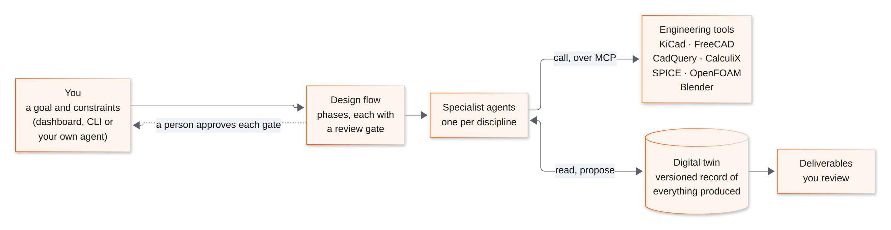

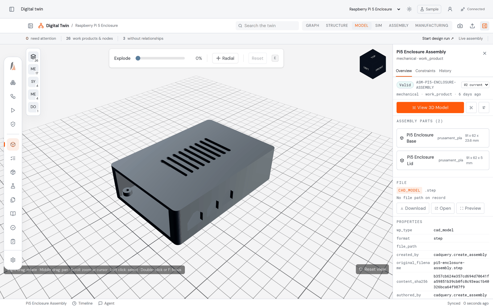

*An enclosure built through the CAD adapter. Every part is named, carries the material
it was assigned and the dimensions it came out at, and links to the STEP file it was read from.*

**Contents:**
[What is it](#1-what-is-metaforge) ·
[Who is it for](#2-who-is-it-for) ·
[What you can do](#3-what-can-you-do-with-it) ·
[Example](#4-a-simple-example-from-request-to-result) ·
[Quick start](#5-quick-start) ·
[Using it](#6-using-metaforge) ·
[Understanding results](#7-understanding-the-results) ·
[Features today](#8-features-available-today) ·
[Limitations](#9-limitations-and-human-review) ·
[Examples](#10-examples-and-tutorials) ·
[FAQ](#11-frequently-asked-questions) ·
[Troubleshooting](#12-troubleshooting-and-support) ·
[Privacy](#13-data-and-privacy) ·
[Developer setup](#14-developer-setup) ·
[Technical overview](#15-technical-overview-and-integrations) ·
[Roadmap](#16-roadmap) ·
[Contributing](#17-contributing) ·
[Licence](#18-licence-and-third-party-notices)

---

## 1. What is MetaForge?

Designing a physical product means keeping many things consistent at once: the
mechanical parts, the circuit board, the firmware, the analysis that says it will not
break, and the paperwork. Normally these live in separate tools and separate heads.

MetaForge puts them in one place:

- **You say what you want**, in plain language, with the constraints that matter.
- **AI agents do the legwork**: they draw CAD, check circuits, run stress and
  airflow analysis, source parts and write test plans, by driving the same tools an
  engineer would.
- **Everything is recorded** in a *digital twin*: a versioned graph that links each
  requirement to the part that meets it and the evidence that proves it.
- **You stay in charge.** The work stops at review gates. You approve, ask for a
  retry, send it back for rework, or reject.

MetaForge does not replace engineering judgement or physical testing. It does the
repetitive work and keeps the record, so your attention goes to the decisions.

## 2. Who is it for?

| If you are... | MetaForge gives you... |
|---|---|
| **A hardware engineer or small team** (drones, IoT, embedded products, enclosures, brackets) | A first draft of CAD, electronics, BOM and analysis to review and correct, with the evidence attached |
| **A maker or founder without a full engineering team** | A guided route from idea to a buildable design, with checks and warnings where you would otherwise guess |
| **An engineering lead who must sign off** | An audit trail: who approved what, on what evidence, against which requirement |
| **A developer building on AI agents** | An MCP server and plugins that let Claude Code, Codex or your own agent use real engineering tools safely |

You do not need to write code to use the dashboard. You do need Docker to run it.

## 3. What can you do with it?

| Capability | In practice |
|---|---|
| **Turn a goal into a design plan** | Start a design run and get a requirements phase, a design phase and verification, each ending in a review gate |
| **Model parts and assemblies** | Parametric CAD with CadQuery and FreeCAD; every part named, with a library material and its measured dimensions |
| **Check designs with analysis** | Stress and vibration (CalculiX), circuits (SPICE), steady internal airflow (OpenFOAM), mesh convergence checks |
| **Design electronics** | Schematic and board checks (KiCad ERC/DRC), BOM and Gerber export, and generated starter projects |
| **Source parts** | Live stock and price lookups from Digi-Key, Mouser, Nexar, Farnell and Arrow when you add the keys |
| **Choose how to make it** | Rank manufacturing processes for your quantity and material, then review the design against the chosen process |
| **Render it** | Rendered images with Blender, in the materials you assigned |
| **Keep a trail** | Requirements, decisions, evidence, baselines and every agent session are stored and searchable |
| **Use your own AI agent** | Claude Code and Codex plugins expose the same tools; writes are held for your approval |

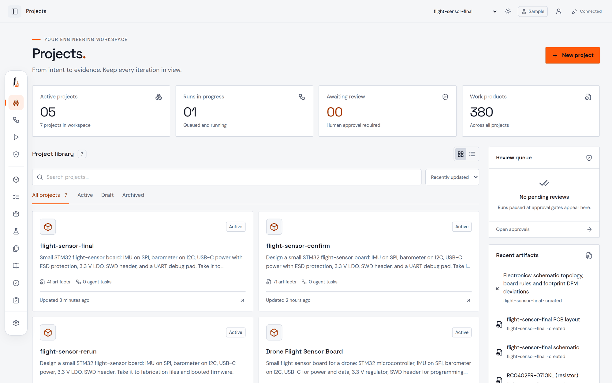

## 4. A simple example: from request to result

**The request.** You want a protective enclosure for a Raspberry Pi 5.

**1. Ask.** In the dashboard choose *New design run*, pick a project and describe the
intent. Or from a terminal:

```bash
forge design --flow mech_v1 "a printable PLA enclosure for a Raspberry Pi 5, \
  with ventilation, mounting for the board's four screw holes, and a 2 mm wall"
```

`mech_v1` is the flow for a load-bearing part or mechanical subsystem. Its phases are
*Requirements*, *Manufacturing Route and Process Selection*, *Mechanical Design*,
*DFM Review and Manufacturing Plan* and *Simulation and V&V*.

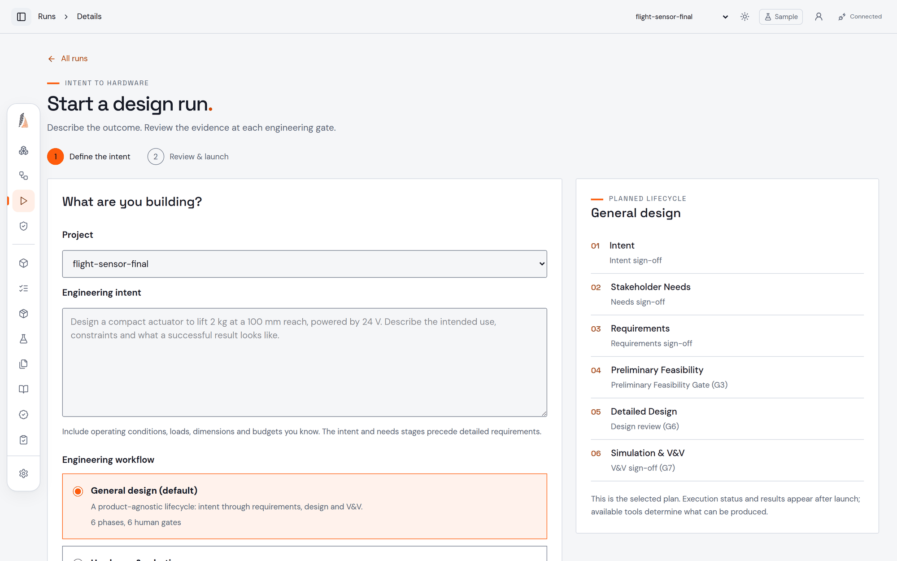

**2. Watch it work.** The run page shows each phase, the tools being called and the
parts appearing in the twin as they are committed.

**3. Review at each gate.** When a phase finishes the run waits for you. The
*Approvals* page shows what was produced, the checks that passed or failed, and why
the gate is held. You approve, retry, send the phase back for rework, or reject.

**4. Read the result.** Open the digital twin to see the model and its record.

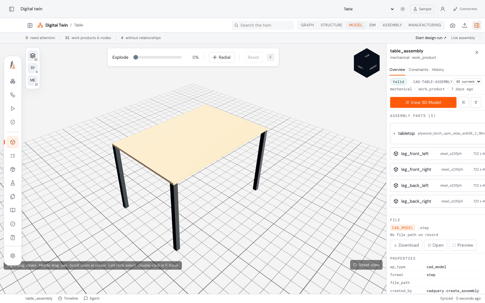

**5. Build or iterate.** Export the STEP, GLB, STL or BOM, print a fit coupon, or go
round the loop again with a change.

Here is the same run as a sequence of events:

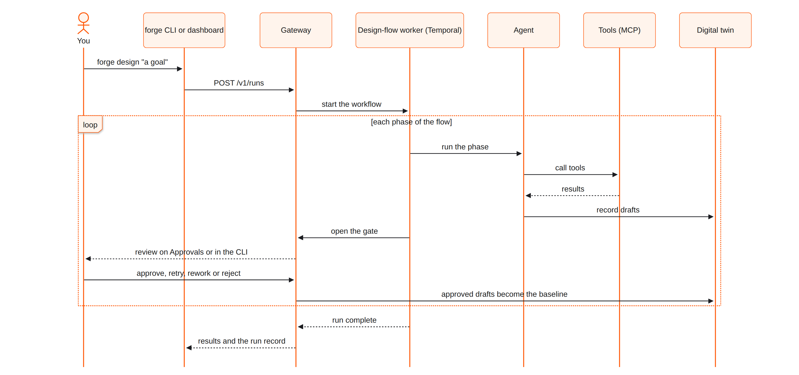

## 5. Quick start

**You need:** Docker with Compose, and room for it: the stack is many containers,
and the optional CFD adapter alone reserves 12 GB of memory. MetaForge is developed
and tested on Linux and on Windows through WSL 2. For the AI features, an API key from
a model provider (Anthropic, OpenAI or OpenRouter), or a ChatGPT/Codex subscription.

**One command** installs the stack, the `forge` command and your first project:

```bash
curl -fsSL https://raw.githubusercontent.com/FidelOdok/MetaForge/main/scripts/install.sh | bash
```

It is safe to run again. It asks eight things in order:

| Step | What it does |
|---|---|
| 1. Mode | *usage* (built images, generated secrets) or *develop* (editable source, hot reload) |
| 2. Tool adapters | Which of KiCad, CalculiX, CadQuery and FreeCAD to start (skip any you do not need) |
| 3. Preflight | Checks for Docker Compose and a suitable Python |
| 4. Model provider | An API key, a ChatGPT/Codex sign-in, or configure it later |
| 5. Secrets | Generates every password into `.env` (permissions 600) |
| 6. Start the stack | Pulls the gateway image, starts the services and waits until they are healthy |
| 7. `forge` CLI | Installs the command-line tool |
| 8. First project | Creates a project and runs a demo chat turn |

Only the command-line tool: add `-s -- --cli-only` after `bash`. Every flag, including
unattended installs, is listed by `scripts/install.sh --help`.

**Check it worked:**

```bash
curl -s http://localhost:8000/health          # the gateway answers
forge projects list                           # your first project is there
```

Open the dashboard at **http://localhost:3000**. Then start with a conversation
(`forge chat`) or a design run (`forge design "..."`).

## 6. Using MetaForge

**Everyday actions**

| I want to... | Dashboard | Terminal |
|---|---|---|
| Start a design | *New design run* (`/runs/new`) | `forge design "<goal>"` |
| See what needs my decision | *Approvals* | `forge approvals` |
| Approve or reject a gate | Approve, retry, rework or reject on the card | `forge runs approve <id>` / `forge runs reject <id>` |
| Look at the model | *Twin* | `forge twin ...` |
| Ask a question about the design | The conversation drawer on *Twin* | `forge chat --project <id>` |
| Check the bill of materials | *BOM* | |
| Add reference documents | *Knowledge* | `forge ingest <file>` |
| Review what an agent did | *Sessions* | |
| See requirement and gate status | *Requirements*, *Run detail* | `forge runs get <id>` |

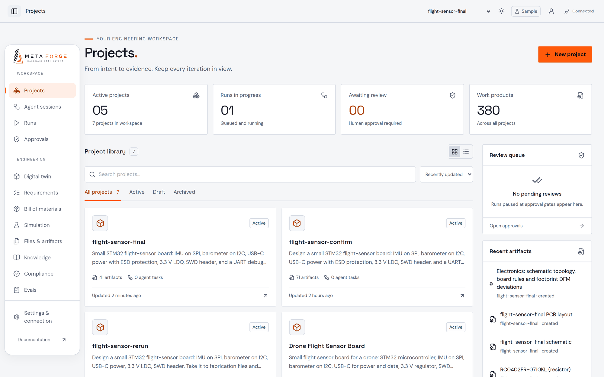

**Where things are.** Twenty routes, grouped by purpose:

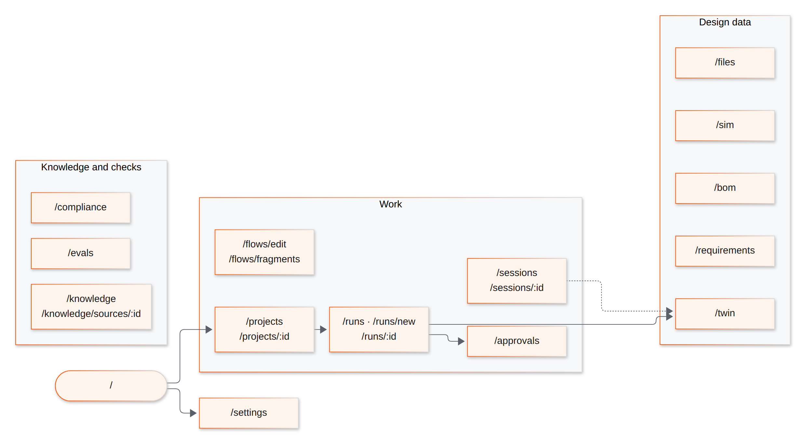

Every page is described in the [dashboard tour](docs/dashboard-tour.md).

**The terminal** has an interactive assistant too (`forge chat`) that calls tools and
answers from what they return:

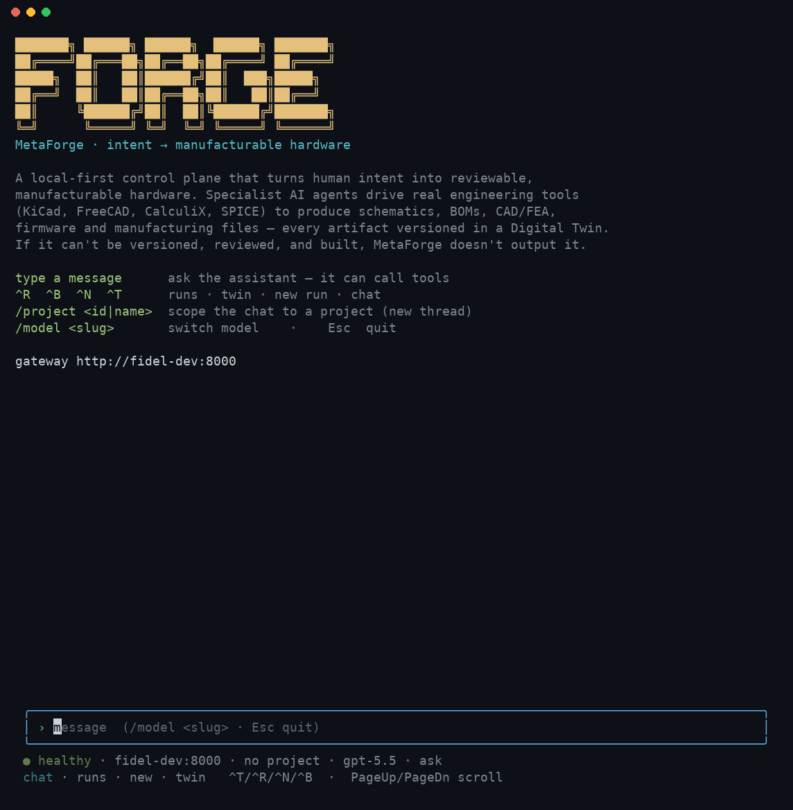

**Reviewing results.** Treat every gate as a code review. Open the card, read the
findings, look at the model, and decide. The dashboard sends your decision to the
gateway, which records who decided, from where, and on what.

## 7. Understanding the results

| You will see | It means |
|---|---|
| **Work product** | Anything MetaForge produced or you imported: a CAD model, a schematic, a BOM, a simulation result, a decision |
| **Revision, `KEY@n`** | A work product is an *item* with numbered revisions. Reviewing means comparing `@2` with `@1` |
| **Draft** | Produced during a run and not yet accepted. Drafts become the baseline only when you approve the gate |
| **Gate** | A pause where a person decides. Approve, retry, rework (send back to an earlier phase) or reject |
| **Evidence** | A real tool result: a stress run, an ERC report, a measurement. Evidence records which design revision it analysed |
| **Stale** | The design changed after the evidence was produced. The claim it supported is no longer proven |
| **pass / fail / uncertain / no data** | The verdict on a requirement. *No data* is not a pass: it means nothing has measured it yet |
| **Constraint** | A limit the design must meet (mass, deflection, safety factor). Checked against evidence |
| **DFM verdict** | *manufacturable*, *not manufacturable* or *incomplete* (with what is unknown) for the chosen process |
| **Held call** | An agent tried to write something and is waiting for your approval. It appears on *Approvals* |
| **Material figure** | A strength or density taken from the material library, never guessed. A missing figure is reported as unknown |

**Warnings to take seriously.** "Objective NOT met" in a gate summary, a requirement
with *no data*, evidence marked *stale*, a mesh that has not converged, and any
number shown with no source.

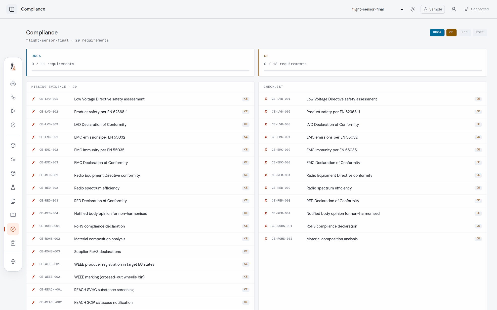

## 8. Features available today

Status is stated plainly. **Working** means it is built, tested and used end to end.
**Early** means it runs but is narrow or not yet proven. **Experimental** means
expect rough edges.

| Area | Status | Notes |
|---|---|---|
| Dashboard (20 routes), `forge` CLI and interactive TUI | Working | |
| Design flows: `design_v1`, `hardware_v1`, `mech_v1`, gates, retry and rework | Working | Flows are versioned and frozen at approval |
| Digital twin: items, revisions, baselines, requirements, evidence | Working | Neo4j and Postgres |
| CAD authoring (CadQuery, FreeCAD), STEP and GLB viewer, named parts and library materials | Working | Part colours come from the STEP file |
| Structural analysis (CalculiX): static, modal, thermal | Working | Check mesh convergence yourself |
| Circuit simulation (SPICE) | Working | |
| Schematic and board checks (KiCad ERC and DRC), BOM and Gerber export | Working | |
| KiCad write: generate a schematic, board and routed layout from a circuit | Early | Generates *new* project folders only; it never edits your own files |
| Steady internal airflow (OpenFOAM) | Early | On the finest mesh it matched a pipe's pressure drop within 0.1 percent. Turbulence models are **not** validated |
| Manufacturing process ranking and DFM review | Working | Process limits must be sourced; missing ones are reported as unknown |
| Studio renders (Blender) | Working | |
| Part sourcing (Digi-Key, Mouser, Nexar, Farnell, Arrow) | Working | Needs your own API keys |
| Knowledge base (ingest documents and datasheets, search with citations) | Working | |
| Agent session capture and the approvals ledger | Working | |
| Claude Code and Codex plugins (local and over HTTP) | Working | Over HTTP, writes are held for you |
| claude.ai web connector (OAuth) | Early | The custom connector works; the packaged plugin connector is not confirmed |
| Compliance checklists (CE, UKCA, FCC, PSTI) | Early | Coverage tracking. It is **not** certification |
| Gazebo, Isaac Sim, Omniverse USD adapters | Experimental | Opt-in |
| IDE assistants (VS Code, KiCad, FreeCAD plugins) | Experimental | Not updated recently. Do not rely on them |
| Multi-user accounts and hosted service | Not in this repository | See [Open core](#15-technical-overview-and-integrations) |

The full tool-by-tool list, kept current, is the
[capability matrix](docs/capability-matrix.md). At least 113 MCP tools register on a
bare install, and more load as you enable adapters.

## 9. Limitations and human review

**MetaForge produces drafts for an engineer to check. It is not a certifying body and
it does not guarantee a design is safe, legal or buildable.** Before you build,
order parts, fly, or rely on a design:

- **Check the numbers that matter**: loads, materials, wall thicknesses, tolerances,
  clearances, voltage and current limits. Confirm the inputs the agent assumed.
- **Read the evidence, not the summary.** A passing gate means the checks that ran
  passed. Look at which checks ran, and which did not.
- **Verify analysis.** Confirm the mesh converged, the boundary conditions are right
  and the result is plausible against a hand calculation.
- **Treat airflow results with caution.** Only steady, incompressible internal flow
  is supported, and turbulence models are not validated.
- **Check electronics yourself.** ERC and DRC catch rule violations, not bad design.
  Generated KiCad projects are starting points.
- **Confirm part data.** Prices, stock and lead times come from distributors and
  change. Datasheet values come from documents you ingested.
- **Compliance is a checklist, not a certificate.** Regulated products need
  qualified assessment.
- **Test physically.** Print a fit coupon, run a bench test, do a fly or load test.
- **AI can be wrong.** Agents can misread a requirement or invent a value. The
  platform refuses unsourced material figures and holds writes for approval, but a
  person must still decide.

## 10. Examples and tutorials

**Guided projects**

| Start here | What it shows |
|---|---|
| [Getting started](docs/getting-started.md) | Install, ingest a document, search it, in three tracks (CLI, Claude Code, dashboard) |
| [Drone flight controller](examples/drone_flight_controller/README.md) | A full reference project: PRD, constraints, BOM, board and firmware through the whole stack. The demos use mock adapters, so they run without Docker |
| [Project structure](docs/project-structure.md) | How a project's files map into the twin |
| [Dashboard tour](docs/dashboard-tour.md) | Every page, with screenshots |
| [CLI reference](docs/cli-reference.md) | Every command |

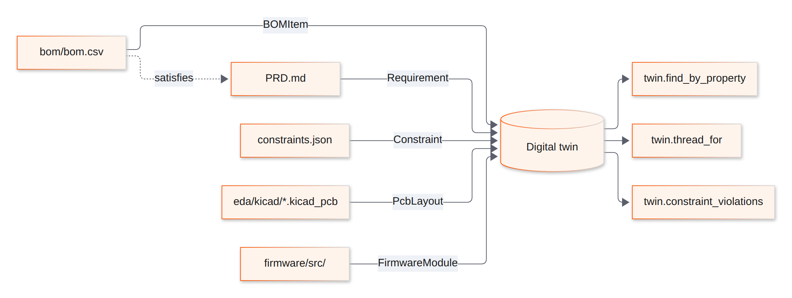

**Sample prompts**

```bash
# A mechanical part, with the manufacturing route chosen first
forge design --flow mech_v1 "a 3 mm aluminium bracket that holds a 120 g camera \
  and survives a 4 g shock, machined on a 3-axis mill"

# A complete hardware system: mechanical, electronics, firmware, simulation
forge design --flow hardware_v1 "a 3-inch ducted indoor drone with a flight \
  controller, 250 g all-up mass and a 6 minute flight time"

# A general design with requirements first
forge design --flow design_v1 "a wall-mounted holder for a 10-inch tablet"

# Ask questions of a project
forge chat --project <project-id> --message "Which requirements have no evidence yet?"
```

Ask for one thing at a time and state the limits that matter: mass, loads, size,
material, quantity, how you will make it, and any standard it must meet.

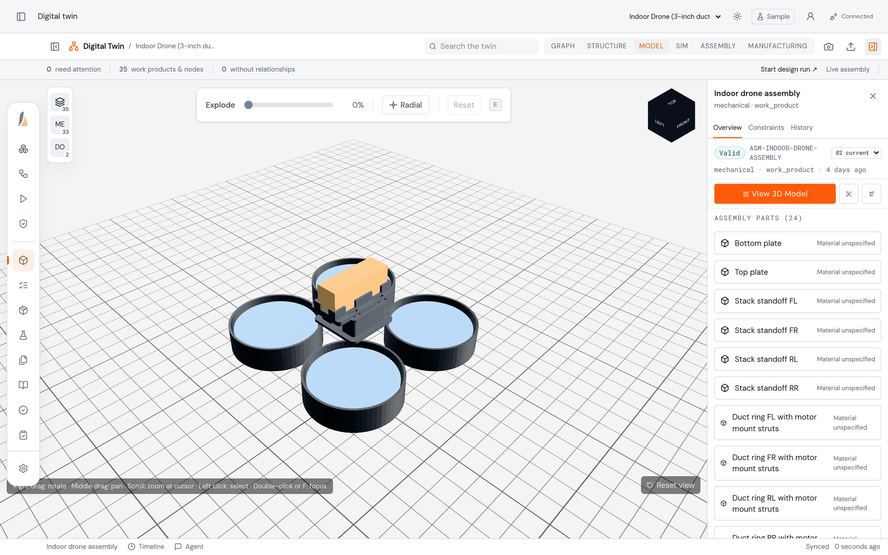

## 11. Frequently asked questions

**Do I need to code?** No, not to use the dashboard or `forge chat`. You need to run
one install command. Developers can script the CLI and the API.

**What files does it understand?** CAD: STEP, GLB, STL and 3MF are viewed in the
dashboard. KiCad projects (`.kicad_sch`, `.kicad_pcb`). Documents: Markdown, PDF
datasheets and CSV can be ingested into the knowledge base. BOMs: CSV.

**What does it cost?** MetaForge is free software under the Apache licence. You pay
your model provider for the AI calls you make (or use a ChatGPT/Codex subscription),
and any distributor or search service you choose to enable. Brave Search has a free
tier. There is no MetaForge subscription for a self-hosted install.

**Does it need a GPU?** No. Blender renders on the CPU, and no adapter requires a GPU.

**Does it work offline?** The stack runs locally. Anything that calls a model
provider, Brave Search or a part distributor needs the internet. Without a model
provider the dashboard and the tools still run, and the assistant does not.

**Which AI models?** Anthropic, OpenAI, OpenRouter, or a ChatGPT/Codex subscription.
You choose and can switch in *Settings*.

**Can my own AI agent use it?** Yes. Install the Claude Code or Codex plugin
([section 15](#15-technical-overview-and-integrations)).

**Is my design sent to a server of yours?** No. See [Data and privacy](#13-data-and-privacy).

**Can it design anything?** No. It focuses on electronics-heavy products and
mechanical parts: drones, IoT devices, embedded boards, enclosures, brackets.
It covers a handful of specialist disciplines, not every engineering field.

**Can it order parts or start a build?** It can look up and compare parts. Any action
with a real-world effect is held for your approval.

## 12. Troubleshooting and support

| Symptom | Try |
|---|---|
| `docker compose` says a password is unset | Run `scripts/install.sh`, or fill the blank credentials in `.env` ([section 14](#14-developer-setup)) |
| The dashboard says *Unavailable* | Check `curl http://localhost:8000/health` and that the containers are healthy with `docker compose ps` |
| A tool you expect is missing | The adapter is probably not enabled or failed to start; see [adapters dropped at startup](docs/troubleshooting.md#adapter-x-dropped-silently-at-startup) |
| An approval does not appear | Check the project filter; items with no project are counted separately |
| A held call times out | Approve it within the window (100 seconds when the client sends no progress) |
| Search returns nothing | Ingest a document first, and check the knowledge service is running |

More in the [troubleshooting guide](docs/troubleshooting.md).

**Getting help.** Search or open an issue on
[GitHub Issues](https://github.com/FidelOdok/MetaForge/issues). Include the output of
`curl -s http://localhost:8000/health`, what you ran, and the log lines around the
failure (`docker compose logs gateway`). Remove any keys first.

## 13. Data and privacy

A self-hosted MetaForge keeps your project data on your own machine or server and
needs no account. A search of the code finds no third-party analytics or
crash-reporting service; telemetry goes to the observability stack you run.


**What is stored, and where**

| Data | Where |
|---|---|
| Projects, runs, sessions, approvals | Postgres |
| The digital twin (items, revisions, requirements, evidence) | Neo4j |
| CAD, renders and result files | The object store (SeaweedFS) |
| Agent sessions and decisions | Postgres, with a record of every tool call |
| Credentials | `.env` on your machine (permissions 600) and the gateway's store |
| Logs, metrics and traces | Loki, Prometheus and Tempo in your stack |

**Who can see it.** With no authentication provider (the default, for a local
single-user setup) anyone who can reach the gateway can read it, so keep it on
localhost or behind your own network controls. For a shared server, set
`METAFORGE_AUTH_MODE`; the gateway then refuses to start unless a provider is
installed ([authentication](docs/deployment/authentication.md)).

**What leaves your machine, and only if you configure it**

| Service | What it receives |
|---|---|
| Your model provider (Anthropic, OpenAI, OpenRouter, Codex) | Your prompts, the project brief, and tool results the assistant reads |
| OpenRouter (optional) | Text sent for knowledge property extraction and component intent search |
| Brave Search (optional) | Web search queries and fetched page requests |
| Part distributors (optional) | Part numbers and quantities |
| GitHub Container Registry | Image pulls during install and update |

Choose a provider whose terms fit your design's confidentiality. Do not put secrets or
export-controlled data into a prompt.

**Export.** Download CAD files (STEP, GLB, STL) and the BOM from the dashboard or the
API (`/v1/cad-export`); Gerbers come from the KiCad export tool. Everything is stored
on your own machine, so you can also copy it directly.

**Delete.** Deleting a project in the dashboard or with `forge projects delete`
removes the **project record only**. Its work products, stored files and run history
are separate. Delete a work product through the twin. To remove everything on a
machine, stop the stack and delete its volumes:

```bash
docker compose down -v        # removes the databases, object store and logs
```

**Retention.** MetaForge sets no automatic expiry on project data, run history,
sessions or logs. Keep, back up or delete them as your policy requires, and take your
own backups. The Claude Code session-capture hook can be turned off with
`METAFORGE_SESSION_CAPTURE=off`.

This repository contains no hosted service, so a self-hosted install has no privacy
policy of ours to accept. The hosted service, where offered, is separate and has its
own terms.

## 14. Developer setup

**Prerequisites:** Git, Docker with Compose, Python 3.11 or later, and Node 22 for the
dashboard and docs site.

**The quick way** (editable install, hot-reload containers, source bind-mounted):

```bash
git clone https://github.com/FidelOdok/MetaForge.git
cd MetaForge
./scripts/install.sh --develop
```

**By hand:**

```bash
git clone https://github.com/FidelOdok/MetaForge.git && cd MetaForge
python -m venv .venv && source .venv/bin/activate
pip install -e ".[dev,knowledge,cadquery]"

cp .env.example .env            # then fill the blank credentials below
docker compose up -d postgres neo4j gateway dashboard
```

Compose refuses to start a service whose password is blank, on purpose, so no install
shares a published default. Generate each one:

```bash
openssl rand -base64 24         # run once per blank value
```

**Configuration.** An example with no secrets (`.env.example` is the full list):

```bash
# Ports
GATEWAY_PORT=8000
DASHBOARD_PORT=3000

# Service credentials: you generate these (leave blank and compose refuses to start)
NEO4J_USER=neo4j
NEO4J_PASSWORD=
POSTGRES_PASSWORD=
MINIO_SECRET_KEY=               # the object store's secret key
TEMPORAL_POSTGRES_PASSWORD=
GRAFANA_PASSWORD=               # only with the observability profile

# Model provider
METAFORGE_LLM_PROVIDER=anthropic    # anthropic | openai | openrouter | openai-codex
METAFORGE_LLM_API_KEY=              # your provider key; none for openai-codex

# Optional services (each adapter turns itself off when its key is absent)
BRAVE_API_KEY=                  # web.search and web.fetch
OPEN_ROUTER_API_KEY=            # knowledge property extraction
DIGIKEY_CLIENT_ID=
DIGIKEY_CLIENT_SECRET=
MOUSER_API_KEY=
NEXAR_CLIENT_ID=
NEXAR_CLIENT_SECRET=
FARNELL_API_KEY=
ARROW_LOGIN=
ARROW_API_KEY=

# Access control
METAFORGE_AUTH_MODE=off         # off for local single-user; a provider name for shared use
METAFORGE_MCP_API_KEY=          # guards the HTTP MCP endpoint; set before exposing it
```

| Credential | What it is for | Where to get it |
|---|---|---|
| `NEO4J_PASSWORD`, `POSTGRES_PASSWORD`, `MINIO_SECRET_KEY`, `TEMPORAL_POSTGRES_PASSWORD`, `GRAFANA_PASSWORD` | Protect the services MetaForge runs for you | You generate them |
| `METAFORGE_LLM_API_KEY` | Calls to your model provider | Anthropic, OpenAI or OpenRouter |
| `BRAVE_API_KEY` | Web search | [brave.com/search/api](https://brave.com/search/api/) |
| Distributor keys | Live stock and price | Each distributor's developer portal |
| `METAFORGE_MCP_API_KEY` | Bearer key for the HTTP MCP endpoint | You generate it |

**Verify:**

```bash
curl -s http://localhost:8000/health | python -m json.tool     # status ok, auth_mode off
python -m cli.forge_cli projects list
cd dashboard && npm install && npm test                        # from the dashboard directory
pytest tests/unit -q
ruff check . && ruff format --check .
```

Dashboard on a hot-reload port: `cd dashboard && npm run dev` serves at
http://localhost:5173. Docs preview: `cd docs-site && npm install && npm start`.

Regenerate a diagram after editing its `.mmd` source in `docs/assets/diagrams/`:
`node scripts/render_diagrams.mjs`.

## 15. Technical overview and integrations


The rules the design follows: agents never call tools directly (everything passes the
MCP registry); the digital twin owns all state; writes are read-only until a person
approves; and everything is versioned.

**Drive it from your own agent.** MetaForge speaks MCP. Install **one** package:

```
/plugin marketplace add FidelOdok/MetaForge
/plugin install metaforge          # reaches a gateway over HTTP, signs in with OAuth
```

```
pipx install "git+https://github.com/FidelOdok/MetaForge.git"
/plugin marketplace add FidelOdok/MetaForge
/plugin install metaforge-local    # runs on this machine, no gateway
```

Over HTTP a tool that writes is held for a human on the *Approvals* page. The local
package treats a stdio session as the engineer at the machine, so its writes run
unheld unless your client supports inline MCP elicitation. Either way the server
enforces it. A third package, `metaforge-cloud`, is the HTTP one with the hosted
gateway's address built in. claude.ai and ChatGPT run in someone else's datacentre
and cannot reach `localhost`; read the
[hosted harness guide](docs/integrations/hosted-harness.md) first.

**Technical documentation**

- [Architecture](docs/architecture.md) and [the agent harness](docs/architecture/robust-harness-design.md)
- [Supported integrations](docs/integrations/claude-code.md): [Claude Code](docs/integrations/claude-code.md), [Codex](docs/integrations/codex.md), [MCP config examples](docs/integrations/mcp-config-examples.md)
- API and MCP: [gateway API reference](docs/reference/gateway-api.md), [MCP specification](docs/mcp_spec.md), [capability matrix](docs/capability-matrix.md)
- [Authentication and permissions](docs/deployment/authentication.md) and [approvals](docs/approvals.md)
- [Deployment](docs/deployment/image-only-host.md), [verifying images](docs/deployment/verifying-images.md)
- [Digital twin schema](docs/twin_schema.md) and [skill specification](docs/skill_spec.md)
- Hosted docs: <https://fidelodok.github.io/MetaForge/>

**Open core.** Everything that turns intent into reviewable hardware is in this
repository: the gateway, orchestrator, digital twin, agents, adapters, dashboard and
CLI. A local single-user MetaForge needs no account. The hosted service (accounts,
identity, control plane) is a separate repository that plugs in through two
provider-neutral seams: the `metaforge.auth` entry-point group on the gateway and the
`metaforge:auth` module alias in the dashboard.

## 16. Roadmap

The [roadmap](docs/roadmap.md) says what is released, in progress, planned and not
started, and how the original four-phase plan compares with what was built. **No
delivery dates are currently agreed.** Nothing on the roadmap should be read as
released unless it is also in the [capability matrix](docs/capability-matrix.md).

**In progress:** work product identity and baselines, skill fidelity, airflow
validation, generative simulation and headless CAD authoring.
**Planned, no date:** manufacturing and vendor integration, a reference library,
policy-based approvals for external agents, the next versions of the Claude Code and
Codex plugins, robot-grade simulation, and a layout that scales to large twins.
**Not started:** most of the 25 engineering disciplines; seven have agents today.

## 17. Contributing

Outside contributions are welcome. Report a bug or suggest a change on
[GitHub Issues](https://github.com/FidelOdok/MetaForge/issues). For code, read
[`CONTRIBUTING.md`](CONTRIBUTING.md) for setup, standards and the checks a pull
request must pass, then [`CLAUDE.md`](CLAUDE.md) for the architecture, testing and
observability requirements. Everyone taking part follows the
[Code of Conduct](CODE_OF_CONDUCT.md). By contributing you license your work under
the Apache License 2.0.

Day-to-day planning happens in a private tracker, so internal task references in
history will not resolve for you. Nothing needed to review a change depends on them.

## 18. Licence and third-party notices

MetaForge is developed by idroneinnovations, the trading name of idroneimages ltd, and
is licensed under the [Apache License 2.0](LICENSE). Attribution is in
[`NOTICE`](NOTICE).

Tools that MetaForge drives, and services it depends on, are separate programs with
their own licences, for example KiCad, FreeCAD, CalculiX, OpenFOAM and Blender. They
run in their own containers or processes and exchange files with MetaForge. Check each
project's licence before you redistribute an image that includes one. Reference
datasheets cached under `tests/fixtures/datasheets/` are excerpted for technical
testing only; the original vendor copyrights apply (see
`tests/fixtures/datasheets/README.md`). A complete generated inventory of dependency
licences is not yet published.
