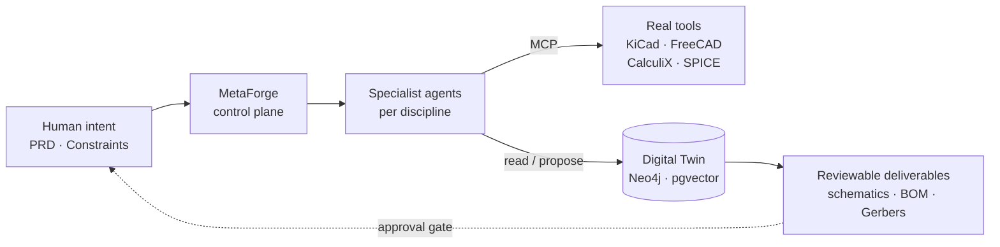
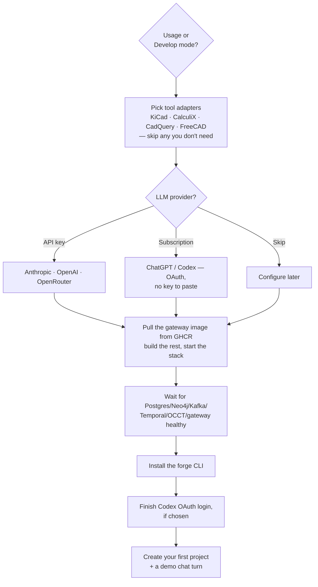

# MetaForge

**Local-first control plane for hardware design.** MetaForge turns
engineer intent — PRDs, constraints, design decisions — into
reviewable, manufacturable hardware deliverables. It orchestrates
specialist AI agents that drive real engineering tools (KiCad,
FreeCAD, CalculiX, SPICE) over the
[Model Context Protocol](https://modelcontextprotocol.io), and
keeps every step versioned and auditable.

> **Prime rule:** if it can't be versioned, reviewed, and built —
> MetaForge doesn't output it.

### See it in action

A real turn in the interactive `forge` TUI — the assistant calls a
tool, then answers from what it returned:


More screenshots (welcome screen, the Runs pane) in the
[CLI reference](docs/cli-reference.md#what-it-looks-like).



## Phase 1 — what works today

- **121 MCP tools** across 20 adapters — knowledge, twin, constraint,
  CAD (CadQuery, FreeCAD), analysis (CalculiX), EDA (KiCad), project,
  memory, session and more. Counted in
  [`docs/capability-matrix.md`](docs/capability-matrix.md), which is the
  list that gets kept current.
- **Python CLI** at `cli/forge_cli/` — `run`, `status`, `twin`,
  `proposals`, `approve`, `reject`, `ingest`, `sources`.
- **Dashboard** with 11 routes (projects, sessions, approvals, BOM,
  3D twin viewer, knowledge sources, …). Vite + React.
- **Gateway HTTP API** with 8 routers; backed by Postgres + Neo4j
  (with in-memory fallback for laptops).
- **Agent session capture** — every agent that drives MetaForge over MCP
  leaves a reviewable trail in `/sessions`: tool *actions* (auto, any
  client), *reasoning* (Claude Code hook / transcript tailer), and typed
  *design decisions* (`twin.record_decision`). See
  [`docs/session-capture.md`](docs/session-capture.md).
- **3 IDE assistants** — VS Code, KiCad, FreeCAD plugins.
- **6–7 specialist domain agents** — focused on electronics-heavy
  products (IoT, drones, embedded). Phase 2 adds 12 more.

Full inventory: **[`docs/capability-matrix.md`](docs/capability-matrix.md)**.

## Quickstart

One script handles Docker, secrets, the `forge` CLI, and your first
project:

```bash
curl -fsSL https://raw.githubusercontent.com/FidelOdok/MetaForge/main/scripts/install.sh | bash
```

It asks whether you want a stable instance or an editable checkout, picks
up an `ANTHROPIC_API_KEY` / `OPENAI_API_KEY` / `OPENROUTER_API_KEY` already
in your environment, and is safe to re-run. Just the `forge` binary and
nothing else: add `--cli-only`.

### High-level flow



Non-interactive / scripted installs, adapter and provider flags, and
`--develop` mode (editable source, hot-reload) are documented in
`scripts/install.sh --help`.

### Manual install

Prefer to do it by hand, or already have a checkout:

```bash
git clone https://github.com/FidelOdok/MetaForge.git
cd MetaForge
python -m venv .venv && source .venv/bin/activate
pip install -e ".[dev,knowledge,cadquery]"
docker compose up -d postgres neo4j gateway dashboard
```

Then either:

```bash
# CLI
python -m cli.forge_cli ingest tests/fixtures/knowledge/sample.md
python -m cli.forge_cli sources list
```

…or open `http://localhost:5173/knowledge` for the dashboard, or
drive MetaForge from a Claude Code session — the repo's `.mcp.json`
is already wired.

To capture your agent sessions (thoughts, actions, decisions) into the
digital thread from any repo:

```bash
pipx install "git+https://github.com/FidelOdok/MetaForge.git#subdirectory=tools/session_capture"
metaforge-capture install --user --gateway-url http://localhost:8000
```

Five-minute walkthrough: **[`docs/getting-started.md`](docs/getting-started.md)**.

## Drive it from your own agent

MetaForge speaks MCP, so your harness can do the engineering rather than
the dashboard. There are two packages, and you install **one**:

```
/plugin marketplace add FidelOdok/MetaForge
/plugin install metaforge          # reaches a gateway over HTTP
```

```
pipx install "git+https://github.com/FidelOdok/MetaForge.git"
/plugin install metaforge-local    # runs on this machine, no gateway
```

The HTTP package asks for your gateway's MCP endpoint on first enable, so
it needs one running and reachable — the installer above does not start
one by default (`docker compose up -d mcp-http` in a checkout does). The
local package needs no gateway at all, and no network. Either way, a tool
that writes is held for a human; held calls land on the dashboard's
Approvals page.

Codex and the per-client details are in
[`docs/integrations/`](docs/integrations/claude-code.md).

## Documentation

- **User Guide:** [getting started](docs/getting-started.md) ·
  [CLI reference](docs/cli-reference.md) ·
  [dashboard tour](docs/dashboard-tour.md) ·
  [session capture](docs/session-capture.md) ·
  [project structure](docs/project-structure.md) ·
  [capability matrix](docs/capability-matrix.md) ·
  [troubleshooting](docs/troubleshooting.md)
- **Integrations:** [Claude Code](docs/integrations/claude-code.md) ·
  [Codex](docs/integrations/codex.md) ·
  [MCP config examples](docs/integrations/mcp-config-examples.md) ·
  [LightRAG UI](docs/integrations/lightrag-ui.md)
- **Reference example:** [drone flight controller](examples/drone_flight_controller/README.md)
- **Architecture & roadmap:** [architecture](docs/architecture.md) ·
  [roadmap](docs/roadmap.md)
- **Hosted docs site:** <https://fidelodok.github.io/MetaForge/>

## Local docs preview

The site is Docusaurus; the markdown it renders stays in `docs/`.

```bash
cd docs-site
npm install
npm start                 # http://localhost:3000/MetaForge/
```

## Status

**Phase 1 (v0.1)** — single-user, local. Schematic generation +
multi-user collaboration ship in later phases. See
[`docs/roadmap.md`](docs/roadmap.md) for the full plan.

## Open core

Everything that turns intent into reviewable, manufacturable hardware is
here: the gateway, the orchestrator, the digital twin, the agents, the
tool adapters, the dashboard and the CLI. A local, single-user MetaForge
is the whole product, needs no account, and talks to no service of ours.

What is *not* here is the hosted service — accounts, the Supabase-backed
identity layer and the control plane behind them. That lives in a
separate repository and plugs in through two documented seams:

- **Gateway**: an auth provider registered on the `metaforge.auth`
  entry-point group. See
  [Gateway authentication](docs/deployment/authentication.md) for the
  three-member protocol and how to write your own.
- **Dashboard**: the `metaforge:auth` module alias, which resolves to
  `dashboard/src/auth/none.ts` by default.

Both seams are provider-agnostic. Running MetaForge against your own
identity provider is a supported path, not a workaround, and nothing in
this repository is shaped to make the hosted option the easy one.

## Contributing

This README is for engineers **using** MetaForge. If you want to
**contribute**, start with [`CONTRIBUTING.md`](CONTRIBUTING.md) for the
workflow and the checks a PR has to pass, then
[`CLAUDE.md`](CLAUDE.md) for the architecture, the testing taxonomy and
the observability requirements. Everyone taking part is covered by the
[Code of Conduct](CODE_OF_CONDUCT.md).

Bugs and proposals go to
[GitHub Issues](https://github.com/FidelOdok/MetaForge/issues). Day-to-day
planning happens in a private Jira project, so the `FORGE-<n>` references
in commit messages will not resolve for you — nothing needed to review a
change is behind them. (`MET-<n>` is older still, from before the move off
Linear.)

## License

MetaForge is licensed under the
[Apache License 2.0](LICENSE); attribution is in [`NOTICE`](NOTICE).

Reference datasheets cached under `tests/fixtures/datasheets/` are
excerpted for technical-reference UAT testing only — original vendor
copyrights apply, see `tests/fixtures/datasheets/README.md`.
