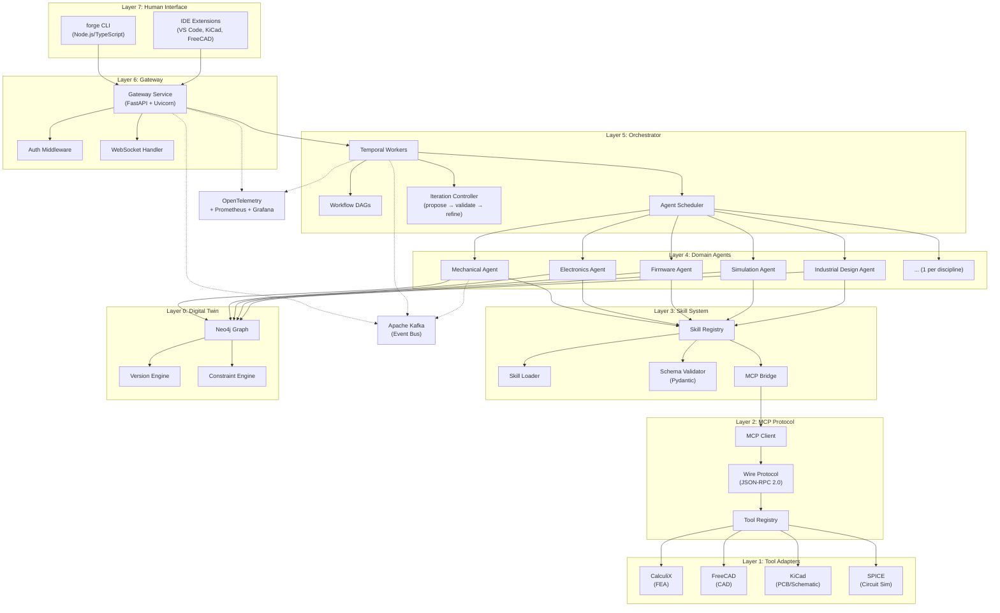
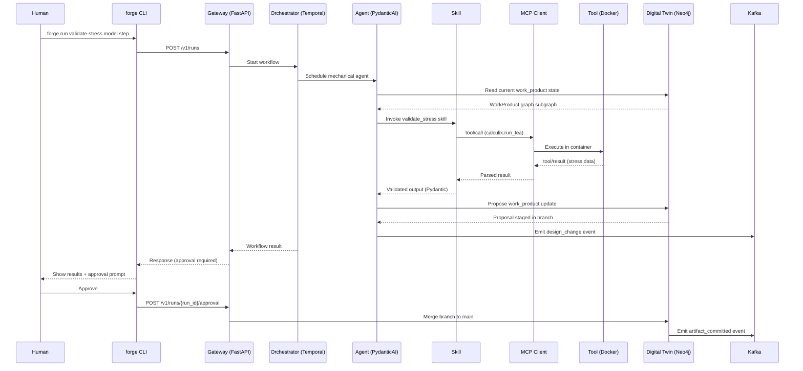

# MetaForge System Architecture

> **Version**: 0.1 (Phase 0 — Spec & Design)
> **Status**: Draft
> **Last Updated**: 2026-03-02

## 1. Overview

MetaForge is a **local-first control plane** that turns human intent into reviewable, manufacturable hardware work_products. It orchestrates specialist AI agents — one per engineering discipline — that interface with real engineering tools (KiCad, FreeCAD, CalculiX, SPICE) to produce schematics, BOMs, PCB layouts, firmware scaffolds, manufacturing files, and test plans.

### Prime Rule

> If it can't be versioned, reviewed, and built — MetaForge doesn't output it.

### Architectural Invariants

These five rules are non-negotiable across all phases:

1. **Agents never call tools directly** — all tool access goes through the MCP protocol layer.
2. **Digital Twin owns all state** — agents read from and propose changes to the Twin; they do not maintain their own state.
3. **Human-in-the-loop** — read-only by default; explicit approval is required for any write operation.
4. **Skills are the atomic unit** — every agent capability is a deterministic, schema-validated, independently testable skill.
5. **Git-native** — every work_product is versioned, diffable, and reviewable. No opaque blobs.

---

## 2. Technology Stack

| Component | Technology | Notes |
|-----------|-----------|-------|
| Primary Language | Python 3.11+ | Gateway, Agents, Twin, Skills, MCP |
| CLI / Dashboard | Node.js / TypeScript | CLI only (`forge` binary) |
| CLI Libraries | Commander.js, Inquirer, Chalk | Interactive terminal UX |
| Gateway | FastAPI + Uvicorn | HTTP/WebSocket API server |
| Agent Framework | PydanticAI + Temporal | ADR-001: structured agent outputs + durable workflows |
| LLM Providers | `openai` + `anthropic` SDKs | Unified abstraction layer; which features need a model, and which settings drive each, are in [model usage](architecture/model-usage.md) |
| Validation | Pydantic v2 | All schemas, configs, messages |
| Workflow Engine | Temporal (Python SDK) | Durable execution, retries, sagas — see [wired vs in-process](#durable-tiers-wired-vs-in-process) |
| Graph Database | Neo4j | Digital Twin work_product graph |
| Event Bus | Apache Kafka | Design change events, audit log — in-process bus when unconfigured, see [wired vs in-process](#durable-tiers-wired-vs-in-process) |
| Observability | OpenTelemetry + structlog | Traces, metrics, structured logs |
| Monitoring | Prometheus + Grafana | Dashboards, alerts |
| Containerization | Docker | Tool adapter isolation |

### ADR-001: PydanticAI + Temporal

The agent framework decision (ADR-001) selects **PydanticAI** for structured LLM interactions (type-safe tool definitions, validated outputs, dependency injection) and **Temporal** for workflow orchestration (durable execution, retry policies, saga patterns). This combination replaces the originally planned custom orchestration layer.

- **PydanticAI** handles: agent definition, tool registration, structured output parsing, LLM provider abstraction.
- **Temporal** handles: workflow DAGs, agent coordination, timeout/retry policies, long-running design loops, state persistence.

### Durable tiers: wired vs in-process

The table above states the *chosen* technologies. This section states which of
them a running deployment actually uses, because the two diverged for six
months and the docs did not say so.

Both Temporal and Kafka were built in March 2026 (MET-186, MET-197) and were
**dead in every deployment** until they were wired (MET-197/MET-186 wiring):
the image installed only the `[gateway]` extra, so `aiokafka` and `temporalio`
were absent, and both modules were written to degrade gracefully without their
SDK. Measured on the live stack before the fix: the Kafka broker had **zero
topics ever created**, and the Temporal server had **zero workflow executions
ever**, while `KAFKA_BOOTSTRAP_SERVERS` and `TEMPORAL_HOST` were passed to the
gateway and read by no Python code.

| Tier | Status | What runs |
| --- | --- | --- |
| **Event bus** | ✅ wired | `create_kafka_bus()` when `KAFKA_BOOTSTRAP_SERVERS` is set — dispatches in-process to every subscriber **and** persists to the topic. Falls back to the in-process bus if the broker is unreachable. |
| **Consolidation cadence** | ✅ two drivers, pick one | the gateway's asyncio `ConsolidationScheduler` (default), or `ConsolidationWorkflow` on the Temporal worker with `METAFORGE_CONSOLIDATION_INTERVAL_SECONDS=0` |
| **Design-flow runs** (`/v1/runs`) | ✅ wired (FORGE-401) | `DesignFlowWorkflow` on the `metaforge-design-flows` queue, served by the `design-flow-worker` service. Runs survive a gateway or worker restart, including runs parked at a gate. The in-process executor remains as the test double behind `METAFORGE_FLOW_ENGINE=in_process`, and there is **no automatic fallback** to it. |

So Temporal is **runnable and registered**, owns the consolidation pass when
you hand it over, and as of FORGE-401 is the execution path for design-flow
runs.

### Gate announcements (FORGE-489)

When a design-flow run reaches a gate, the workflow's `announce_gate` activity
tells the gateway. The `design-flow-worker` binds a real announcer that calls
`POST /v1/runs/{id}/gate-opened` (`METAFORGE_GATEWAY_URL`, plus
`METAFORGE_GATEWAY_API_KEY` when the gateway needs one). The gateway re-reads
the workflow, moves the run's record to `awaiting_approval` with the gate's
reason, and so lists it on the Approvals page and publishes it on the run's
SSE stream. If the run was started from an agent session, a `decision` event
saying the run is waiting is appended to that session. There is no MCP
`resources/updated` push channel in the plugin yet; callers see the gate through
`flow.status` (`awaitingGate`) and the session event.

Announcing never approves. A gate is answered only by `POST /v1/runs/{id}/approval`.

`metaforge_design_flow_gate_announce_total{outcome}` counts `announced`,
`unannounced` (no announcer wired, which also logs `design_flow_gate_unannounced`)
and `failed` (the gateway could not be reached). The
`DesignFlowGateUnannounced` alert fires on the last two.

### Where a held write actually waits (FORGE-406)

FORGE-359 built an approval gate. Nothing outside the test suite ever
constructed one, so the MCP sidecar ran with `approval_gate=None` and **every
write from a plugin was refused** with *"no approval gate is configured"*.
The guardrail was present, correct, thoroughly tested and unreachable.

Underneath that was a second problem it had been hiding: the approval store
is a process-level `InMemoryRunStore` in the *gateway*. Even once wired, a
call held inside the sidecar would sit in a queue the dashboard cannot see.

So the sidecar parks held calls in the gateway's ledger over HTTP
(`POST /v1/chat/tool_approvals`), and polls for the decision. There is
exactly **one** ledger.

A hold is closed by whichever side stops waiting (FORGE-466). The sidecar
calls `POST /v1/chat/tool_approvals/{id}/resolve` with `timed_out` when its
window closes and `canceled` when the call is cancelled; the in-process wait
(chat harness, in-gateway MCP gate) does the same on its own store. The
route is idempotent and returns `409` for a hold a human already decided, so
a decision landing as the window closes is read back and honoured, not
overwritten. Closing is best-effort: a failure is logged and counted
(`metaforge_tool_approval_resolution_total{result="failed"}`), never raised
into the tool call. As a backstop for a waiter that dies silently, each hold
stores an `approval_deadline` (the waiter's `timeout_seconds` plus 30s of
grace), and every read of the ledger expires overdue holds as `timed_out`
(`trigger="deadline"` on the same counter). Answering a `timed_out` or
`canceled` hold is a `409` naming the state and reason. A second store per process would have been the more
obvious fix and the wrong one: two queues means a reviewer clearing one while
the other fills, and no page that shows both.

`METAFORGE_GATEWAY_URL` selects it. Unset, the sidecar falls back to its own
in-process queue — correct when the MCP server runs *inside* the gateway,
wrong in a sidecar — and **logs that choice on every start-up**, because the
whole reason this went unnoticed is that the absence was only observable at
the moment somebody tried to write.

The approver comes back off the ledger entry (FORGE-393), so identity
survives the process boundary without anything being asserted across it.

### Flows through the harness plugins (FORGE-400)

Flows were dashboard-only: an agent in Claude Code or Codex could not see
that any of it existed. Four MCP tools and a run resource change that.

| Tool | |
| --- | --- |
| `flow.list` | the catalogue, as the gateway will run it (read) |
| `flow.propose` | tailor a template to an intent; the version it writes is **held** for a person, the call is not (FORGE-471) |
| `flow.status` | phase state for one run (read) |
| `flow.start_run` | start a run on an **approved** version; refused with 409 otherwise, so the call is not held (FORGE-471) |

Plus `metaforge://flow/run/{id}`, the run as markdown for a client with no
canvas, and a `/metaforge:flow` prompt.

**The rule that shapes the surface: the agent has no tool that approves its
own call.** `flow.propose` returns a proposal and an approval id and stops.
There is no `flow.approve`. An agent that could both propose and approve has
an approval step in name only — and the name is worse than nothing, because
it appears in the audit trail. Approving happens where a human is: the
dashboard queue, or inline elicitation (FORGE-360), both through the same
ledger, with the approver taken from that record (FORGE-393).

`flow.status` is deliberately *not* held. An agent following a run calls it
repeatedly; holding every poll for a human would make following a run
impossible.

**Served by the sidecar too (FORGE-462).** Until FORGE-462 only the gateway
passed the flow bindings to `bootstrap_tool_registry`. The adapters register
only when a binding is supplied, so the HTTP sidecar (which every harness
plugin talks to) skipped both `design_flow` and `run`, and none of `flow.*`
or `run.*` reached any plugin. The sidecar now builds them in
`metaforge/mcp/__main__.py` (`_build_flow_bindings`), chosen the same way as
the approval gate above:

- `METAFORGE_GATEWAY_URL` set: `metaforge/mcp/remote_flows.py` calls the
  gateway's own routes (`GET /v1/design-flows`,
  `POST /v1/design-flows/propose`, `POST /v1/runs`, `GET /v1/runs/{id}`,
  `GET /v1/runs/{id}/flow-state`). The flow-version store, the approval
  ledger and the run store are all process-level, so this is what makes a
  proposal from a plugin the one the dashboard shows and a run from a plugin
  one `/v1/runs` lists. Results have the same shape as the in-process
  bindings, asserted by test.
- Unset: the in-process bindings, correct only inside the gateway, with
  `mcp_flow_bindings_in_process` logged at start-up.

**Answering the approval decides the version.** Approving a proposal used to
move the approval and nothing else: the flow version stayed `proposed` and
`POST /v1/runs` refused it with 409 forever, so "approve, then start" could
not be completed from anywhere. `POST /v1/chat/tool_approvals/{id}` now
carries the decision to the version for `design_flow_proposal` and
`design_flow_version` approvals, with the approver taken from the approval
record (FORGE-393).

**What checking this found.** A catalogue-wide test — "no tool lets a caller
answer its own approval", matched on behaviour rather than on one forbidden
name — turned up two tools with the identical FORGE-393 bug:
`twin.approve_design_loop` took `approved_by` as an argument and
`twin.approve_engineering_change` took `approver`. FORGE-393 had fixed
promotion and guarded `ect.approve` against a *blank* approver, which is not
the same as guarding it against a supplied one. Both now read the approver
from the approval record, and both are in `HUMAN_AUTHORITY_TOOLS`.

### Client intelligence mode and gates in the chat (FORGE-581, FORGE-582)

A run can have its phase work done by the connected MCP client (Claude Code,
Codex) instead of a model the gateway calls. The mode is per run:
`intelligence` on the run request (`flow.start_run` takes it), else the
deployment default `METAFORGE_INTELLIGENCE`, else `server`. A value that is
not a mode is a 422, never a quiet fall back to the server's model. The mode
is fixed when the run starts and travels in the workflow input.

**A client-mode phase is a task.** The `run_phase` activity calls no model.
It posts the phase to `/v1/client-tasks` with the brief a phase brain would
have been given (goal, objective, required deliverables and slots, flow
context, retry feedback, earlier summaries) and waits, heartbeating, for a
submission. The client lists tasks with `phase.list_tasks`, takes one with
`phase.claim`, does the work through MCP tools and hands it back with
`phase.submit`. The gate that follows checks the twin exactly as it does
after a server phase: a deliverable described in the summary but not
recorded fails it. `phase.submit` also takes `outcome` (`complete`, the
default, or `incomplete`). A client that did not meet the phase's objective
submits `incomplete`; the phase then finishes with status `incomplete` and
its gate reads not ready with that finding, whatever the twin holds
(FORGE-590). Before this, a summary saying "objective NOT met" still reached
the person as an approvable gate.

- The task id is `run:phase:attempt`, so a retried activity finds the task
  (and any submission) the first attempt posted. A worker that stops
  withdraws its open task; the retry reopens it.
- Tasks live in SQLite next to the run ledger
  (`METAFORGE_CLIENT_TASKS_PATH`, default `~/.metaforge/client_tasks.db`), so
  a gateway restart does not lose one a client is working on.
- A task can only be opened for a run that exists and started in client
  mode (404 or 409 otherwise).
- The in-process engine uses the same tasks through `ClientPhaseBrain`.
- The `ClientTasksUnanswered` alert fires when tasks were posted for two
  hours and none came back.

**Writes during a client phase: held, unless the owner opts in
(FORGE-584).** By default a remote client's twin writes go through the
ordinary guardrail, so each is held for a person (answered in the chat where
the client supports elicitation). The owner can set
`METAFORGE_CLIENT_TASK_WRITES=on` on the MCP sidecar (it also needs
`METAFORGE_GATEWAY_URL`). Then:

- `phase.claim` is still a held write, so the person approves letting the
  client take the phase, once.
- From then on, calls in that MCP session (which must send a stable
  `X-MetaForge-Session`) run as the `client_task` caller. Before each call
  the sidecar asks the gateway whether the task is still `claimed`, the run
  is `running` in client mode, and the run belongs to the session's project.
  Anything it cannot confirm fails closed: the call is held as before.
- A `client_task` caller has the design-flow worker's bounds: no
  `project.*`, `flow.*` or `run.*` administration (except `flow.await_gate`),
  no human-authority tools, nothing destructive, and nothing outside the
  run's project. Those calls are refused, not held. Its writes carry the
  run and phase, so they land as drafts in the run's change set.
- The grant ends when the client calls `phase.submit`, or when the gateway
  stops confirming the claim. Every call it covers is logged
  (`mcp_client_task_call_authorised`).

**Gates are answered by the person, in the chat.** `flow.await_gate` waits
for the run's next gate and asks the person through MCP elicitation, with
only the decisions the gate allows. The decision is recorded through the
same approval service as a dashboard click, with `surface: "chat"` and the
person from the authenticated MCP session as approver. Dismissing the prompt
leaves the gate open. This keeps the FORGE-400 rule intact: the agent still
has no tool that approves anything; the tool asks. See
[Gates in the client chat](approvals.md#gates-in-the-client-chat).

### The run record follows the workflow (FORGE-485)

The gateway's run record is a cache of the workflow. A Temporal run used to
stay `queued` for its whole life (the workflow runs in another process and
never told the gateway), and the ledger behind the record only remembers
`queued` for a restored run. Writes made by a run's phases are checked against
the record, so they were refused with "run is queued, not running", and a run
parked at a gate read `queued` after a restart and `POST /v1/runs/{id}/approval` returned
409 (`cannot transition queued -> running`), so no one could answer it.

The record is set `running` as soon as the workflow starts. For a live run on
the Temporal engine it is then reconciled from the workflow, at all times and
not only after a restart: by a background pass every few seconds, on `GET /v1/runs/{id}`, on `GET /v1/runs`, on the approval route,
and at gateway start-up (in the background, so a slow Temporal never delays
boot). Status, and for a gate the `approval_reason` (the gate name and its
check summary), are taken from the workflow's `state` query. The approval route
reconciles first and then signals the workflow, so a decision is accepted
whenever the workflow is waiting at a gate, whatever the local record said.
The approver is read from the request (FORGE-393) and relayed with the signal.

Reconciling is read-only toward Temporal and never guesses: if the workflow
cannot be queried (no worker, engine down) the record is left untouched, and
an approval against a record that still says `queued` is refused rather than
sent to a gate nobody has seen. A run already terminal in the record is never
reopened, and in-process runs are not reconciled.

### Watching a run (FORGE-396)

`GET /v1/runs/{id}/flow-state` returns phase-by-phase state, queried from the
Temporal workflow rather than from a projection of it. A cache that can be
stale is a live view that is sometimes wrong, with nothing on the page saying
which.

The dashboard draws it as a graph (`@xyflow/react`): a node per phase coloured
by status, the gate card on the node, and approval answerable from the graph
so a reviewer does not navigate away from the thing being approved. Selecting
a phase shows its activity beside it.

**The distinction the whole view turns on is `unknown` versus `pending`.** A
workflow *query* is answered by a worker, so with none running there is nobody
to answer — and an engine that is down renders identically to a flow that has
not started if "could not read" is allowed to become "not yet". One of those
is an outage. So the response carries `live: false` and a reason, the phases
still list (a run whose shape is known and whose progress is not should show
the shape), and every status reads `unknown`.

Known gaps, stated rather than papered over:

- **The activity lane does not yet show tool calls, decisions, evidence or
  token cost.** Those come from session capture and twin commits, which the
  workflow's event log does not carry. The panel names what is missing instead
  of rendering empty headings — an empty "Tool calls" section reads as "this
  phase made none".
- **It polls at 2s rather than streaming.** The run SSE stream carries status
  transitions only: it is fired by the run store's `on_transition`, which a
  phase starting inside the workflow never touches. Publishing phase events
  into that stream is its own change. A poll is honest about being a poll; an
  SSE subscription that silently only updated on status changes would look
  live and not be.

### Editing a flow, and where an edited flow lives (FORGE-399)

FORGE-398 generated a proposal, held it for approval, and stored only a *text
diff* of it — so approving one gave nobody a flow to start. `versions.py`
closes that, and it is shared: an edited flow needs exactly the same thing,
and two stores would have been two answers to "which flow did this run use".

**A version is immutable.** Editing produces a new version with a new id,
never a mutation, because a run pins the version it started on (FORGE-401
freezes it into the workflow input and verifies its hash), so a version
changing underneath would make a completed run's provenance a lie — and an
approval that can be edited afterwards is not an approval. That is also what
makes *"edits never change a running flow"* structurally true rather than a
policy somebody has to observe.

| Endpoint | Purpose |
| --- | --- |
| `POST /v1/design-flows/validate` | check an edit **without saving it** |
| `POST /v1/design-flows/versions` | save an edit as a new version, held for approval |
| `GET /v1/design-flows/versions/{id}` | fetch a stored version |

Versions are durable (FORGE-482). The store used to be process memory, so a
gateway reload lost every proposal and every human approval while the Temporal
run using the version survived, and `flow.start_run` then answered "no flow
version". Each version is now written through to SQLite
(`~/.metaforge/flow_versions.db`, override `METAFORGE_FLOW_VERSIONS_PATH`,
skipped by `METAFORGE_RUNS_LEDGER_DISABLE` like the run and approval ledgers)
with its status, frozen definition, content hash, template and version,
approval id, approver and timestamps, and restored at startup. A restored row
whose hash no longer matches its content is skipped and logged, never run.
Approved and rejected versions are immutable; the approval ledger still
drives the decision (FORGE-462). The in-memory store remains the test double.

`POST /v1/runs` accepts a `flow_version_id`. An unapproved version is refused
there with a 409 rather than at the gate: starting work on a flow nobody
agreed to and asking afterwards is the shape this epic exists to prevent.

Validation is a separate call from saving so a rule break appears **while the
person is looking at the change that caused it** — by save time they have made
five more edits and have to work out which one the message is about. The
editor holds no validity logic of its own: a second copy of the rules in the
client would be a second answer, and the copy that disagrees is the one that
lets an unstartable flow through the UI to be refused at save.

An edit that breaks an invariant **cannot be saved** (422), and nothing is
stored when a save is refused. Saving a flow identical to its template is also
refused: an approval with nothing to approve teaches reviewers to click
through, which is how a real one later gets clicked through too.

The diff is prose rather than a structural patch, because it is read by a
person deciding whether to approve. Relaxations are shouted —
`phase 'x' NO LONGER requires 'y'` — since tightening a gate is normal and
loosening one is the change most worth attention and easiest to lose in a long
list.

### Tailoring a flow to a project (FORGE-398)

`POST /v1/design-flows/propose` takes a project's intent and returns a
tailored flow held for a human.

**The model does not write a flow.** It proposes operations from a closed set,
and the server applies them to a versioned template:

| Operation | Effect |
| --- | --- |
| `drop_phase` | the phase does not apply to this product at all |
| `add_deliverable` | require an artifact, so the phase's gate demands it |
| `set_disciplines` | the disciplines a phase fans out into |

That is the design, and the reason is worth stating. Asking a model for a
whole flow and validating the result puts the invariants in a position where
they must catch everything — and "the validator will catch it" is the
reasoning that ends with a release gate quietly missing because somebody added
a rule later than the flow that broke it. Removing a gate, removing a
deliverable and switching enforcement off are **not expressible**. The
FORGE-397 validator still runs, as a backstop rather than the only line.

Note the asymmetry: tailoring may make a flow **stricter, never laxer**. A
model that thinks a simulation is unnecessary can drop the whole phase —
visible in the diff and answerable by the person approving — but cannot keep
the phase and stop checking its output.

Every operation carries a rationale; one without is discarded, because a flow
that differs from its template and cannot say why is a flow nobody can review.
An operation naming a phase that does not exist is skipped rather than fatal,
so a model that misremembers one id does not lose the changes it got right,
and the diff describes what actually happened rather than what was asked for.

**Nothing starts from a proposal.** The response carries an `approvalId` into
the same ledger the dashboard Approvals page already watches, and this
endpoint has no ability to create a run — which is how "nothing starts before
approval" is made true rather than asserted.

**Every proposal names the model that wrote it (FORGE-468).** The configured
primary and the model that answered can differ, because the provider pipeline
falls back when the primary fails. The propose response carries
`generatedBy: {provider, model, fellBackFrom}` (`fellBackFrom` is
`"<provider>:<model>"` of the primary when a fallback answered, else `null`),
and the held approval's request payload carries the same thing as
`generated_by`, so the person approving can see whose tailoring it is. Both
are optional and `null` when unknown.

If no model is reachable the endpoint returns 503 and makes no proposal. There
is no untailored fallback: a flow the human believes was tailored, and was
not, is worse than being told the generator is down, because they would
approve it on the strength of a tailoring that never happened.

#### The generator asks before it tailors (FORGE-463)

An intent alone is not enough to tailor a flow. `"A wall shelf I can make
with what I have."` used to come back as `mech_v1` with simulation dropped
("practical load testing will suffice"), no questions and `valid: true`,
because nothing said what the shelf carries, what "what I have" is, or how
far the person wanted to go. The request now carries that context:

| Field (camelCase; snake_case also accepted) | Meaning |
| --- | --- |
| `manufacturingContext.route` | `in_house`, `vendor` or `undecided` |
| `manufacturingContext.processes` / `machines` / `stockMaterials` | what the person can actually make it with; `machines` are free-form capability descriptions |
| `manufacturingContext.productionQuantity` | how many |
| `targetMaturity` | `concept`, `sim_validated`, `physically_validated` or `released` |
| `loadsAndUse` | free text; `unknown` is a valid answer |
| `budget` | optional |

**Missing inputs are asked for, not guessed.** If the route, the target
maturity or the loads are missing (or the route is `in_house` with no stated
processes, machines or stock), the endpoint answers `200` with
`status: "needs_input"` and one grouped list of questions, each with an `id`,
the `question`, `why` it matters, an `answerType` (with `options` for
choices) and the request `field` the answer goes in. It carries **no flow, no
stored version and no held approval**. The required questions are
MetaForge's own and deterministic (`orchestrator/design_flow/context.py`);
the model may add at most three product-specific ones, marked
`source: "model"`. If the model is unreachable the required questions are
still returned, with a note saying the product-specific ones are absent.

**The flow is manufacturing-led.** With the context present, the prompt
carries it and tells the model to derive process and material choices from
the stated capabilities. Every change also records a server-written `basis`
(the route, processes, machines and stock it was made under), so a reviewer
sees what the generator was told even if the model did not cite it. An
`undecided` route adds a gated **Manufacturing Route Selection** phase ahead
of the first geometry phase, rather than letting the generator pick a route.
That operation (`add_route_selection`) is server-only: a model cannot add
phases.

**The route gate needs a decision, not a deferral by default (FORGE-608).**
The phase's decision is recorded with `twin.record_decision` and a typed
`manufacturing_route`: either `route` (`in_house` or `vendor`) with
`process` and `material_class`, or `deferred: true` with a `reason`. The
recorder refuses anything else, `route: undecided` included. The gate (both
engines) reads the project's latest decision that carries one:

- none at all, or only free-text decisions: the gate is not ready, and its
  missing list names the `manufacturing_route` decision. Approve is not
  offered;
- a chosen route: ready, and the gate summary names the route, process and
  material;
- a deferral: ready, and the gate summary says `route DEFERRED: <reason>
  (approving accepts the deferral)`, so accepting it is the person's explicit
  choice.

This closed the gap the Table run showed: its route phase recorded "route
NOT SELECTED (deferred)" as prose, the gate passed, and the design went ahead
on assumed materials without the gate saying so.

**Process before design, DFM after it (FORGE-611).** `mech_v1` (template
1.2.0) now has two manufacturing phases on every run, both with the
`manufacturing` discipline (its own tool profile and skill cards):

| Phase | Where | Skill | Gate reads |
|---|---|---|---|
| `route_selection` (Manufacturing Route & Process Selection) | before `design` | `rank_manufacturing_processes` | `manufacturing_route` plus `process_ranking` |
| `dfm_review` (DFM Review & Manufacturing Plan) | after `design`, before `simulation` | `check_manufacturability` | `dfm_review` |

The process is chosen first, from what is available, because it constrains
the design (stock sections, sheet sizes, cutter radii, weld access). The
agent ranks 2 to 4 candidates on fit, availability on the route and cost at
quantity, using only sourced capability values (`design_value` entries); a
value it could not source makes that criterion `unknown`. The person picks:
approving the route gate accepts the recommendation, a retry naming another
process records that one. The chosen process's limits go into a constraint
set, and the design phase is told to design to them.

The route gate now also needs the ranking: a chosen route without
`process_ranking` is not ready. A process the person stated up front is a
one-candidate ranking. A deferral needs no ranking.

After the design, `dfm_review` checks each feature (wall thickness, holes,
inside corner and bend radii, draft, overhang, envelope) against the chosen
process's limits and writes the manufacturing plan (stock, operations,
quantity, a unit cost only when sourced). `twin.record_decision` takes the
result as a typed `dfm_review` (`process`, `verdict`, `findings`,
`unknowns`, `plan`). The gate, in both engines:

- none recorded: not ready;
- `not_manufacturable`: not ready, naming the failing features, so the
  design is reworked before simulation is spent on it;
- `incomplete`: ready, with what could not be checked in the summary;
  approving accepts it;
- `manufacturable`: ready, with the process named.

MetaForge cannot yet measure a wall thickness, hole, radius, bend or draft
off the geometry, so those values are declared (the part's authoring
parameters) or stated, and every finding says which. Measured values are
the envelope, volume and mass (`twin.get_node`, `freecad.measure`) and the
3D-printing overhang (`twin.evaluate_overhang_metric`). The `hardware_v1`
`manufacturing` phase (electronics, G8) is unchanged.

**Industrial design before mechanical design (FORGE-634).** `hardware_v1`
(template 1.1.0) and `mech_v1` (template 1.3.0) have an `industrial_design`
phase, with the `industrial_design` discipline (its tool profile and skill
cards), placed where the Planner puts the discipline: before mechanical
design, which depends on the form factor it fixes. In `hardware_v1` it
follows `concept_selection`; in `mech_v1` it follows `route_selection`, so
the chosen process's minimum wall is known.

The phase works through the three skills: `form_factor_envelope` from the
sized contents, clearance and wall (the envelope is recorded with
`twin.record_constraint_set` for mechanical design to work to);
`check_ergonomics` against sourced limits for the users the requirements
state, or a recorded reason that nobody handles the product; and a library
appearance per visible part checked with `check_cmf_compatibility` (the look
is the person's choice). Its required deliverable is one `design_decision`
naming the envelope, the ergonomics verdict, the finishes and every unknown
or assumed value; the gate (Industrial design review) reads it like any
other required deliverable. There is no product-type fact yet, so the phase
runs on every `mech_v1` run as well; a part nobody handles records that, and
tailoring can drop the phase.

**Vendor connectors (FORGE-427).** Quotes and orders from outside vendors
go through connectors on the gateway (`api_gateway/vendors/`). Every
connector is built on one base that guarantees typed failures (never an
empty success), a credential named by a `METAFORGE_VENDOR_*` environment
variable, an explicit `sandbox` or `production` mode that is reported on
every quote and order, and a rate limit. A quote is stored and recorded in
the twin as a `procurement_record`; an order is refused unless its quote is
still valid, unordered and made in the connector's current mode, and is
recorded linked to its quote. `vendor.place_order` is destructive and held
for a person on every call. `health.check` lists each connector's auth
state under `vendors`. A contract suite (`tests/unit/test_vendor_connectors.py`)
runs against every connector; only a fake, sandbox-only vendor is wired so
far (`METAFORGE_VENDOR_FAKE=on`), and real vendors (JLC, then PCBWay) join
it once their API access is approved.

Vendors with no ordering API are handed off instead (FORGE-614):
`vendor.handoffs` reads a small catalogue (`api_gateway/vendors/handoffs.py`:
AISLER, Craftcloud, Xometry, SendCutSend) and, for a service and some work
products, returns each vendor's upload page, accepted formats, the files
that fit and their gateway download paths. It sends nothing; the person
uploads.

Before any quote exists, `cost.estimate_manufacturing` (FORGE-615) gives the
route phase a rough cost for CNC milling or sheet metal from figures the
caller supplies with their sources (shop rate, setup hours, material density
and price, stock or blank size, removal or cut rate). It is in-process
arithmetic, always labelled an estimate and never a price, and a missing
figure leaves what needs it unknown.

**Processes and materials (FORGE-451, FORGE-446).** Beside the machines,
the library holds manufacturing techniques and materials
(`twin_core/library/catalog.py`, the same store file). A *process* has a
family, the machine kinds that run it, the material families it makes, and
rules in the vocabulary `check_manufacturability` reads (wall thickness,
hole diameter, inside corner and bend radius, feature size, draft, overhang,
envelope) plus achievable tolerance; a rule may apply to one material family
only. A *material* has a family, a designation, forms, the processes it
suits, and typed properties (density, stiffness, strengths, elongation,
thermal figures, cost per kg with its currency, and the across-the-grain
pair for woods). The same rules as the machines hold: fixed units, a source
on every value, assumptions flagged for review, nothing defaulted, every
change versioned. Nothing ships built in; entries are recorded with their
sources. `library.process_limits` turns a process, for a material, into DFM
limits and a ranking candidate.

A flow is told about them at proposal, like the machines:
`manufacturingContext.processIds` and `materialIds` (ids or names) put each
entry's rules or properties into the frozen flow context, and an unknown
entry is refused. With none chosen, the context lists the entries that match
what was stated (processes by the stated processes and the library machines'
processes, materials by the stated stock names), or failing that the
library's entries up to fifteen, and says which of the three it did. A
library with no entries leaves the context text as it was.

**Blender renders, and the GPL boundary (FORGE-627, FORGE-628).** Industrial
design reviews need to see a product, so MetaForge renders models with
Blender 5.2.2 LTS in its own container (`blender-adapter`, port 8202):
`blender.render` returns studio PNGs (named views and a turntable, Cycles on
the CPU, headless) and `blender.export_blend` returns the staged scene.

Blender is GPL (version 2 or later; binaries are distributed under GPL
version 3), and blender.org states that scripts using its Python API must be
GPL when published. So the boundary is drawn in code:

- everything that runs inside Blender is `tool_registry/tools/blender/
  bpy_scripts/`, licensed GPL-3.0-or-later with its own `LICENSE`;
- the adapter (MetaForge code) never imports `bpy`; it starts Blender as a
  separate program (`blender --background --python ... -- job.json`) and
  they exchange only files: a mesh and a job JSON in, PNGs, a .blend and a
  result JSON out;
- a test fails if any MetaForge module outside `bpy_scripts/` imports `bpy`
  or `mathutils`;
- the image installs the unmodified blender.org build, checked against its
  published SHA-256, keeps Blender's licence files, and names the matching
  source (`tool_registry/tools/blender/BLENDER_NOTICE.md`).

Renders and .blend files are the user's ("What you create with Blender is
your sole property", blender.org). Models are meshes: a STEP is converted to
GLB first (the OCCT converter), and OBJ, STL and PLY are read Z-up, the CAD
convention.

`twin.render_work_product` (FORGE-630) renders a work product in the twin:
it resolves the stored model, converts a STEP with the same OCCT converter
the dashboard viewer uses, calls `blender.render` over MCP, and keeps the
PNGs as a `render` work product linked to the model (`GENERATED_FROM`, with
the model's content hash). The tool is wired in both the gateway and the MCP
sidecar (`api_gateway/twin/render_recorder.py`). The sidecar's standard
`tools/call` reply turns any `images[].png_base64` in a result into MCP image
content, so a harness such as Claude Code or Codex shows the renders in chat
instead of reading base64 as text (FORGE-373); the gateway's own bridge uses
the legacy dialect and still receives the base64.

A render can show parts in their library appearances (FORGE-632):
`appearances` maps a part name to an appearance, which the renderer reads with
`library.get_appearance` over the same bridge. The appearance's screen colour
(sRGB, converted to Blender's scene-linear values in the GPL script) and its
render roughness and metallic set the part's surface, and the render node
records the appearance and its version, so a render made before the
appearance changed is recognisably stale.

**Mechanical components (FORGE-449).** The library also holds mechanical
parts, in the pattern CAD tools use for them. A *standard* part is built from
its standard's dimension table (`twin_core/library/standard_parts.py`: ISO
4762 socket head cap screws, ISO 4032 hex nuts, ISO 7089 plain washers, deep
groove ball bearings by designation); its specs cite the table row and its
geometry is a generator with parameters, so CAD is made on demand rather
than stored per size. A *purchased* part carries a supplier's STEP (with its
licence) and part numbers. The tables are bd_warehouse's, vendored unmodified
under Apache-2.0 with its licence and a NOTICE (`twin_core/library/data/
bd_warehouse`). bd_warehouse itself is not a dependency: it needs build123d,
whose OCCT build conflicts with CadQuery's in the CAD adapter. A seed of 69
common parts (26 screws, 6 nuts, 6 washers, 31 bearings) builds from the
tables.

**Appearances: colour, material and finish (FORGE-627, FORGE-631).** A fourth
library kind holds what an industrial designer specifies for a surface: the
finish (as made, painted, powder coated, anodised, plated, moulded-in colour,
printed, textured, polished, brushed, bead blasted), the colour, a texture
reference, measurable surface properties (`gloss_gu_60`,
`coating_thickness_um`, `surface_roughness_ra_um`), two render parameters
(`render_roughness`, `render_metallic`, 0 to 1) and the library materials and
processes it applies to. A colour is named in its colour system (`ral`,
`pantone`, `ncs`, a `supplier` code, or `custom`) and carries the sRGB used to
draw it on screen as `srgb_hex`, with its own source: a screen value for a
RAL or Pantone code is an approximation, so it is sourced like any other
figure and an assumed one is flagged for review. Entries follow the
library's rules (fixed units, a source on every value, every change
versioned) and are filtered by finish. No colours ship built in.

**Ergonomic limits (FORGE-635).** A fifth kind holds design limits for the
features people touch, press, reach or lift, in `check_ergonomics`' own
vocabulary and units (grip diameter and width, handle length, finger
clearance, button size, operating height, reach in mm; actuation force in
N; product mass in kg). Each entry names what it applies to (a fingertip
push button, a one-hand bar handle), the population it describes, and its
source; `family` filters by feature kind, and `check_ergonomics` accepts an
entry as it is, citing its name and version. A seed of 30 limits from
MIL-STD-1472H (2020; US Government work, approved for public release) is in
`twin_core/library/data/ergonomic_limits/`: push button sizes and forces
(Figure 14), toggle switches (Figure 16), bar handle clearance and grip
length and minimum handle diameter by item weight (Figure 101), joystick
grips, work surface heights and control panel reach depth, each read from
the standard and cited to its clause or figure. Its population is US
military users (the central 90 percent of males and of females), so
`check_ergonomics` reports it as a mismatch for other users rather than
applying it silently. Paywalled standards (ISO 7250, EN 894) are not
seeded; ANSUR II body measurements are measurements, not limits, and are
not seeded either.

**Material figures come only from the library (FORGE-446, FORGE-457).** The
hard-coded material tables are gone (they held sixteen generic names with no
sources, and an unknown material silently got the density of water). Every
material name a tool call carries is resolved against the library before the
tool runs, by `twin_core.library.material_resolver.fill_material_arguments`
at both dispatch points (the MCP server and the gateway's registry bridge):
each `material` string, each `{"name": ...}` material object and each
`candidate_materials` list gets the entry's figures, with their sources,
beside it. The adapter base server takes them out of the arguments before
any schema sees them and holds them for the call
(`tool_registry.material_context`), so the CAD and FEA containers, which
cannot read the library, still compute with library figures. Inside the
gateway the resolver reads the catalog; the MCP sidecar asks the gateway
(`GET /v1/library/materials/resolve`). Code called outside a tool call
(the design loop, item diffs, evals) resolves through
`api_gateway.library.material_figures.with_materials`.

A name resolves only to an entry it names exactly (identifier, title or
designation). A generic name such as "steel" or "pla" is refused with the
closest entries, so a grade is never picked silently; a missing property is
refused naming the entry and the fix (record it with its source, or pass the
figure explicitly). An explicit figure from the caller always wins.

**The machine library (FORGE-451).** Process ranking and DFM need a
machine's real limits, so machines are recorded once, outside any project,
in the gateway's SQLite store (`METAFORGE_MACHINE_LIBRARY_PATH`, default
`~/.metaforge/machine_library.db`, code in `twin_core/library/machines.py`).
A **model** is a machine type with its spec-sheet capabilities; an
**instance** is one machine (in-house or at a vendor) that points at a
model and overrides what differs. Every capability has a fixed unit and a
source (`manufacturer_spec`, `measurement`, `user` or `assumption`, the
last flagged for review); nothing is defaulted, and every change keeps the
previous version. A connection records only the name of the environment
variable that holds a credential.

`/v1/library/machines` serves it to the dashboard and the sidecar, and the
`library.*` MCP tools to agents: the reads are read-only, the two writes are
held for a person. `library.machine_limits` turns an instance into a ranking
candidate and DFM limits with their sources. The `manage-machines` plugin
skill tells a client how to record a machine and use its limits.

A flow is told about the machines when it is proposed:
`manufacturingContext.machineIds` (`machine_ids` over MCP) names the
library instances the product will be made on, and an id the library does
not hold is refused (422) rather than dropped. Each machine becomes one line
in the flow context (name, id, kind, processes, route, availability, and its
limits: envelope, minimum wall and feature, overhang, bend and corner radii,
tolerance, materials, and any assumptions needing review). With none chosen,
every available instance is listed instead. The lines are resolved once and
frozen with the flow version, so the generator, every phase brain and the
client-mode briefs see the same machines. The route phase passes each
machine's `library.machine_limits` candidate to `rank_manufacturing_processes`,
and the DFM phase checks the design against the chosen machine's limits. A
context with no library machines renders exactly as before.

A networked printer can be read instead of typed in:
`library.discover_machine` reads an OctoPrint, Moonraker (Klipper) or
PrusaLink controller from the gateway and returns a proposed instance whose
figures are `machine_report` values citing the endpoint and time read. It
registers nothing. The controller's key stays on the gateway in an
environment variable whose name must start `METAFORGE_MACHINE_`, so no
other gateway secret can be sent to a machine URL.

Jobs (FORGE-427/440, first slice). `library.dispatch_job` sends a G-code
work product to an idle in-house OctoPrint or Moonraker printer and starts
it. It is the only physical action in MetaForge, so it is annotated
destructive and held for a person on every call. The part's revision is
pinned when the job is sent. `library.job_status` reads the job back from
the machine. `library.record_job_result` records the ended job as
`demonstration` evidence against the pinned revision, reading the outcome
from the machine so a caller cannot assert it; a stopped or failed print is
recorded as not made. Jobs live in the library store (`machine_jobs`).
MetaForge has no slicer, so the G-code is made elsewhere and recorded as a
work product first. PrusaLink machines can be discovered but not yet sent
jobs.

A successful proposal (`201`, `status: "proposed"`) keeps every existing
field and adds `requirementsPending` (true when no requirements were sent),
`assumptions` (including an explicit "requirements pending" line) and
`openQuestions`. The proposal is validated **with** its context before
anything is stored, so a flow that drops simulation while the loads are
unknown is refused with `422 physical-verification-kept`.

`flow.propose` takes the same fields in snake_case. On `needs_input` it
returns the questions and tells the agent to ask the user rather than answer
them itself.

### Caller-proposed tailoring (FORGE-481)

`POST /v1/design-flows/propose` (and the `flow.propose` tool) optionally
accepts `template` and `operations` written by the caller's own model, each
operation being `drop_phase`, `add_deliverable`, `set_disciplines`,
`set_model` or `declare_items` (FORGE-524: the named parts a phase writes, see
[deliverable slots](architecture/design-flow-harness.md#deliverable-slots-carry-item-keys-forge-524))
on a phase of the template, with a `rationale`. When either is
supplied the server makes **no generator model call**, not even for the
optional product-specific questions: it applies the operations with the same
deterministic generator (`parse_caller_operations` then `build_proposal`),
runs the same invariants (including FORGE-463's physical-verification rule),
and holds the same single approval. Unlike the lenient server-model path, an
unknown operation, template or phase, or an operation without a rationale, is
refused with `422` and the reason, because a caller can read the refusal and
correct its call. The required questions still come from the server: a
missing manufacturing route, target maturity or loads still returns
`needs_input`. Provenance is recorded as `proposed_by` (`client`, `model`, from
the optional `caller` object) on the approval and the response, the stored
version has `origin: "caller"`, and `generatedBy` stays empty. Because no
generator call is made, FORGE-476 usage records no `flow_generator` tokens.

### The flow catalogue is served, not copied (FORGE-395)

`GET /v1/design-flows` returns every launchable flow as the gateway will run
it: phases, gate criteria, required deliverables, disciplines, the template
version, and whether the flow passes its own invariants.

It exists because the dashboard used to hold the catalogue itself, in
`dashboard/src/api/endpoints/design-flows.ts`, under a comment asking people
to keep it in sync by hand. It was not in sync, and nothing could have said
so:

- **`design_v1` was missing entirely** — the *default* flow, the one a run
  gets when the request names none, could not be selected in the wizard whose
  purpose is selecting flows.
- four phase titles were paraphrased (`Electronics` for *Electronics Design*,
  `Manufacturing preparation` for *Manufacturing Prep*, two case
  differences), so the wizard described phases by names no run uses.

The short display labels moved into the template files rather than staying in
the dashboard. Serving `name` alone would have moved the drift instead of
removing it: the client would still have had to hold a friendly label per
flow, and that copy would rot the same way.

A flow that breaks an invariant is **listed and marked unstartable**, not
hidden and not silently offered. Offering it and refusing at `POST /v1/runs`
reads as the gateway being broken rather than the flow being wrong; hiding it
makes a flow that exists and cannot be seen.

### Design flows on Temporal (FORGE-401)

`/v1/runs` used to start a design flow as an `asyncio.create_task` in the
gateway process against an `InMemoryRunStore`. A restart lost every in-flight
run, and the runs it lost most expensively were the ones parked at a gate —
those have a human already committed to them.

```
POST /v1/runs ──> freeze_flow() ──> DesignFlowWorkflow (Temporal)
                  template id,          │
                  version,              ├─ phase ──> run_phase activity
                  content hash          │             (heartbeats, 3 retries)
                                        ├─ gate ───> wait_condition + durable timer
                                        │             answered by a signal from
                                        │             the approval ledger
                                        └─ change ─> continue_as_new
```

Four things are worth knowing about the shape:

- **One workflow, not one per flow.** `DesignFlowWorkflow` is an interpreter
  over the approved flow, passed in as *data*. A new template is a data
  change, and every run replays against the same definition.
- **The flow is frozen and hashed at approval.** The workflow verifies the
  hash before it starts. Editing `spec.py` cannot change what an in-flight
  run is doing, and a completed run stays replayable.
- **A gate that is not ready parks; it does not end the run** (FORGE-495). The
  reviewer can retry the phase, with the gate's findings and a reason given to
  the phase brain first, or reject. Earlier approved phases are kept. See
  [Retrying a phase](architecture/design-flow-harness.md#retrying-a-phase-from-its-gate-forge-495).
- **A gate can send the run back to an earlier phase** (FORGE-500). A verdict
  that is really about earlier work (a failed safety factor needs a design
  change) takes a `rework` decision naming that phase: it and every later phase
  re-run with the reason and findings first, earlier approvals stand, and a
  per-run cap bounds the loops. See
  [Sending a run back](architecture/design-flow-harness.md#sending-a-run-back-to-an-earlier-phase-forge-500).
- **A gate that expires is a rejection**, on a durable timer. Not "carry on",
  which would promote work nobody read; not "wait forever", which leaves a
  run that reads as live.
- **A mid-run flow change is only applied at a gate boundary**, via
  `continue_as_new` with the new frozen flow. No phase is in flight there, so
  nothing half-done is orphaned.

### Flow templates and invariants (FORGE-397)

The built-in flows live in `orchestrator/design_flow/templates/*.yaml`, one
file per flow, each carrying a `version`. They were 530 lines of Python
literals in `spec.py`; that was fine while flows were fixed and stops being
fine once a flow can be tailored, because a generated or edited flow is data
and has to be diffable against the template it came from.

Every run records the template id, its version and the content hash of the
frozen flow, so *"which flow did this run use"* has an answer that survives
the template being edited afterwards.

**Invariants are server-enforced** (`invariants.py`), checked before a flow is
approved and again when a run starts — not as a lint somebody can skip. A
violation names the rule and the phase, and the validator reports all of them
at once rather than the first:

| Rule | Why it exists |
| --- | --- |
| `release-gate-exists` | otherwise a flow runs to completion with nobody approving the result |
| `no-pass-without-data` | a gate with no required deliverables cannot tell an empty phase from a complete one, and neither can the human answering it |
| `gates-enforce-what-they-require` | `enforce_deliverables: false` under a gate is a decorative gate — worse than none, because the approval then looks like evidence |
| `deliverable-is-producible` | a gate requiring `simulation_result` before any simulation phase is not a strict flow, it is one that always fails — and it fails at the gate rather than where somebody could have seen it |
| `requirements-are-verified` | a twin full of claims nothing checks reads, on every dashboard, exactly like a product that passed. A phase with id `requirements` counts as recording requirements whatever artifact it uses, so a flow cannot pass this vacuously (FORGE-463) |
| `physical-verification-kept` | a flow that commits a `cad_model` must keep a phase producing `simulation_result` or `verification_report`, or require a `test_plan` at a gate as the recorded alternative. While the loads are unknown, not even a test plan may replace it (FORGE-463) |
| `unique-phase-ids` | readiness, activity history and the live view all key on the phase id |
| `has-phases` | — |

Auto-approved gates are exempt from the human-gate rules: they are
checkpoints, not decisions, and holding them to rules about what a person can
tell apart would force deliverables onto phases nobody reviews.

**If Temporal is unreachable, starting a run fails with a 503 and no run
record is created.** There is deliberately no fall-through to the in-process
executor. That fallback would work, which is the problem: runs keep starting
and nobody discovers the engine is not durable until a restart eats a day's
work. `METAFORGE_FLOW_ENGINE=in_process` selects the old executor explicitly,
warns on every run start that runs are not durable, and is there for tests and
for contributors without Docker.

**Both engines run exactly the approved version** (FORGE-474). A run started
with `flow_version_id` (what `flow.start_run` sends) is pinned to that stored
version on either engine: Temporal receives its frozen flow as workflow input,
and the in-process executor walks a definition rebuilt from the same frozen
flow, after checking its hash and checking that the rebuild reproduces it. A
dropped phase stays dropped and an added deliverable is required. If the
in-process engine cannot reproduce the version exactly, the run is refused
with a `409` and no record is left; it never substitutes the template the
version came from. Every design-flow run records `flow_engine`
(`temporal` or `in_process`), `flow_template_id`, `flow_version`,
`flow_version_id` when it was started from a stored version, and
`flow_content_hash`. `GET /v1/runs/{id}` returns the engine, version id and
hash as top-level fields, and `/flow-state` lists the version's phases rather
than the template's.

Running it needs two services: `temporal` and `design-flow-worker`. Without
the worker a run would be accepted and then sit queued forever, because nothing
polls the queue. So `POST /v1/runs` (and `flow.start_run` /
`run.start_design_flow` through it) checks `DescribeTaskQueue` for pollers on
`metaforge-design-flows` first, cached for a few seconds, and answers `503`
with the reason when there are none. No run record is created. `health.check`
reports the same thing under `design_flow_worker` (`ok`, `absent`, `unknown`).

In dev, `docker-compose.override.yml` mounts the source into `design-flow-worker`
the same way it does for the gateway and `temporal-worker` (FORGE-493), so a
worker fix takes effect on `docker compose restart design-flow-worker` with no
image pull. There is no auto reload, because a reload would kill a phase
mid-turn; Temporal retries an activity a restart interrupts, but restart
between phases when you can.

When a run's live state cannot be read (the workflow query times out because no
worker answers), `GET /v1/runs/{id}/flow-state` and `flow.status` list the run's
own frozen version: the phases of the stored version it was started on, with
status `unknown`, plus `flowVersionId`, `flowVersion` and `flowContentHash`
from the run record. They never fall back to the base template. A run whose
version cannot be read back lists no phases and says so.

A phase that cannot run because of provider configuration (a missing key, an
unusable model) is marked non-retryable by the worker. The workflow then ends
the run as `failed` with `Phase '<id>' failed: <reason>` instead of failing
opaquely; the flow state carries it as `error`, the failing phase shows
`failed`, and the error is repeated in the phase summary.

The worker is a separate process from the gateway, so it wires the two things
a phase brain needs itself (FORGE-475):

- **Tools.** It has no tool registry of its own. On the first phase it connects
  an MCP client to the `mcp-http` sidecar at `METAFORGE_MCP_URL` (default
  `http://mcp-http:8765/mcp`) and installs it where `build_phase_brain` reads
  the bridge, so both engines build the same brain. Every phase's MCP calls
  carry the run's project, actor `agent:design-flow` and one session per run.
  An unreachable sidecar, or one listing no tools, fails the phase with that
  reason rather than running it toolless.
- **Writes (FORGE-487).** The sidecar would otherwise classify the worker as
  `untrusted` and hold every write for a dashboard click. With
  `METAFORGE_MCP_SERVICE_KEY` set on both services (and nowhere else) the
  sidecar treats a call carrying it as `Caller.SERVICE`, but only after asking
  the gateway that the run it names is `running` on an `approved` flow version
  and belongs to the call's project. In-scope writes then run without a
  per-call hold; project, flow and run administration, human-authority tools
  and destructive tools are refused. Provenance carries run id, phase and
  model. With the key unset the worker stays untrusted and its writes are held.
  See [Claude Code integration](integrations/claude-code.md#the-design-flow-worker-is-not-held-per-call-forge-487).
- **Model.** It reads the same `METAFORGE_LLM_*` env and mounts the same
  `metaforge-home` and `codex-home` volumes as the gateway, so a phase resolves
  the provider and model a chat turn would. A phase whose every provider failed
  fails the run with the per-provider reason; when no retry could help (a
  missing key, a model the provider cannot serve) it fails once instead of
  being retried.

Both cadence drivers build the tier through one factory,
`digital_twin.memory.consolidation.bootstrap.build_consolidation_stack()`
(MET-723). Before that existed the wiring lived inside the gateway's lifespan,
so a worker would accept `ConsolidationWorkflow` and then fail its activity with
*"orchestrator was not bound before activity ran"* — the workflow was
registered but could not run. A worker-driven pass is now measured end to end:
eight experiences fetched from pgvector, grouped, synthesized, and the
execution `COMPLETED`.

Because the worker synthesizes in its own process, it needs the same
`OPEN_ROUTER_API_KEY` the gateway has (MET-724). Without it the tier degrades to
`StubLLMClient`, which answers confidence `0.0`; the validator then rejects
every insight, so a pass fetches and synthesizes and still accepts nothing.

The event bus is additive by design: adopting Kafka does not change dispatch
semantics, it adds a durable log, which is what makes the MET-567 deposit
paths replayable rather than best-effort.

---

## 3. System Architecture

### 7-Layer Stack

```
┌─────────────────────────────────────────────────┐
│  Layer 7: Human Interface                       │
│  CLI (forge) · IDE Extensions · Approval UI     │
├─────────────────────────────────────────────────┤
│  Layer 6: Gateway Service (FastAPI)             │
│  HTTP/WebSocket API · Auth · Rate Limiting      │
├─────────────────────────────────────────────────┤
│  Layer 5: Orchestrator (Temporal)               │
│  Workflow DAGs · Agent Scheduling · Iteration   │
├─────────────────────────────────────────────────┤
│  Layer 4: Domain Agents (PydanticAI)            │
│  1 agent per discipline · Skill invocation      │
├─────────────────────────────────────────────────┤
│  Layer 3: Skill System                          │
│  Registry · Loader · Schema Validation · Bridge │
├─────────────────────────────────────────────────┤
│  Layer 2: MCP Protocol Layer                    │
│  Client · Wire Protocol · Tool Registry         │
├─────────────────────────────────────────────────┤
│  Layer 1: Tool Adapters (Docker)                │
│  KiCad · FreeCAD · CalculiX · SPICE             │
├─────────────────────────────────────────────────┤
│  Layer 0: Digital Twin (Neo4j)                  │
│  WorkProduct Graph · Versioning · Constraints      │
└─────────────────────────────────────────────────┘
```

### Architecture Diagram



---

## 4. Dual-Mode Operation

MetaForge supports two operational modes that determine the design loop behavior:

### Assistant Mode (Default)

The human drives the design process. MetaForge validates and advises.

```
Human edits design files
        │
        ▼
  File watcher detects changes
        │
        ▼
  Agents validate post-edit
        │
        ▼
  Results shown in IDE / CLI
        │
        ▼
  Human reviews and iterates
```

- All tool operations are **read-only** by default.
- Validation runs automatically on file changes.
- Agents flag issues but do not modify files without explicit approval.
- Approval gates: per-file, per-agent, or per-session granularity.

### Autonomous Mode

AI agents drive the design loop. Humans review at gate checkpoints.

```
Human provides PRD + constraints
        │
        ▼
  Orchestrator creates workflow DAG
        │
        ▼
  Agents execute: propose → validate → refine
        │
        ▼
  Gate checkpoint: human reviews
        │
        ▼
  Approved → commit to Twin
  Rejected → agents refine
```

- Agents can propose file modifications (writes go through approval).
- The propose → validate → refine loop runs until constraints pass or iteration limit is reached.
- Gate checkpoints are configurable: per-step, per-phase, or end-of-workflow.
- All proposed changes are staged in a Twin branch before approval.

---

## 5. Component Descriptions

### 5.1 Gateway Service (Layer 6)

**Technology**: FastAPI + Uvicorn

The Gateway is the "front door" — the single entry point for all client interactions.

| Responsibility | Details |
|---------------|---------|
| HTTP API | RESTful endpoints for project CRUD, agent status, Twin queries |
| WebSocket | Real-time agent progress, validation results, approval requests |
| Authentication | API key + JWT token-based auth |
| Rate Limiting | Per-client request throttling |
| Request Routing | Dispatches to Temporal workflows or direct Twin queries |

### 5.2 Orchestrator (Layer 5)

**Technology**: Temporal (Python SDK)

The Orchestrator is the "brain" — it coordinates multi-agent workflows as durable Temporal workflows.

| Responsibility | Details |
|---------------|---------|
| Workflow DAGs | Define agent execution order based on dependency graphs |
| Agent Scheduling | Queue and dispatch agent tasks with priority |
| Iteration Control | Manage the propose → validate → refine loop |
| Dependency Resolution | Determine inter-agent data dependencies |
| Failure Handling | Retry policies, compensation (saga pattern), timeout management |
| State Persistence | Temporal handles workflow state durably across restarts |

### 5.3 Domain Agents (Layer 4)

**Technology**: PydanticAI

Each agent is a specialist for exactly one engineering discipline (1:1 ratio). Agents are implemented as PydanticAI agents with typed tool definitions and structured outputs.

| Property | Details |
|----------|---------|
| Ratio | 1 agent : 1 discipline |
| Implementation | PydanticAI `Agent` class with domain-specific system prompt |
| Tools | Skills registered as PydanticAI tools via the Skill Registry |
| State | Stateless — all persistent state lives in the Digital Twin |
| Communication | Via Temporal workflows (agent-to-agent) and Kafka events |

**Industrial design (FORGE-627, FORGE-633).** The Planner's discipline #2
(form factor, ergonomics, DFM-aware aesthetics), scheduled there for Phase 2,
now has its agent: `domain_agents/industrial_design/`. Its three skills are
deterministic and carry no built-in data:

- `form_factor_envelope`: the smallest outer envelope for the product's
  contents (component boxes, positioned or stacked), adding the internal
  clearance and the wall, with volumes, fill ratio and overlaps, checked in
  any orientation against a sourced maximum envelope;
- `check_ergonomics`: grip diameter and width, handle length, finger
  clearance, button size, actuation force, operating height, reach and
  hand-held mass against limits that each name their population and source
  (a cited anthropometric dataset or ergonomics guidance); a limit for a
  different population than the intended users is reported;
- `check_cmf_compatibility`: each part's library appearance against its
  material, using only the materials the appearance records, with the
  finishing processes the choices need and any assumed values to review.

A missing value or limit is `unknown`, never a pass. The `industrial_design`
tool profile (and `DISCIPLINE_PROFILES` entry) gives a phase the renders,
appearances, materials, processes and machine limits, model measurement and
value sourcing; chat exposes the three skills beside mechanical's, and a
project whose description speaks of form factor, ergonomics or finishes (or
that holds renders) is scoped to the discipline. Flow templates do not yet
include an industrial design phase.

### 5.4 Skill System (Layer 3)

**See**: [`docs/skill_spec.md`](skill_spec.md)

Skills are the atomic unit of domain expertise. Each skill is deterministic, schema-validated, and independently testable.

| Property | Details |
|----------|---------|
| Definition | 5-file directory: `definition.json`, `SKILL.md`, `schema.py`, `handler.py`, `tests.py` |
| Validation | Pydantic models for input/output schemas |
| Registry | Auto-discovery + manual registration |
| MCP Bridge | Skills invoke tools exclusively through the MCP protocol |

### 5.5 MCP Protocol Layer (Layer 2)

**See**: [`docs/mcp_spec.md`](mcp_spec.md)

The Model Context Protocol layer provides the wire protocol for all tool access. No agent or skill ever calls an engineering tool directly.

| Property | Details |
|----------|---------|
| Protocol | JSON-RPC 2.0 over stdio (local) or HTTP (remote) |
| Messages | `tool/list`, `tool/call`, `tool/result`, `tool/error`, `health/check` |
| Registry | Tool catalog with capability declarations and health tracking |
| Execution | Invocation lifecycle with timeout, retry, and cleanup |

### 5.6 Tool Adapters (Layer 1)

Tool adapters wrap engineering tools in MCP-compatible servers. Each adapter runs in an isolated Docker container.

| Adapter | Tool | Phase | Capabilities |
|---------|------|-------|-------------|
| CalculiX | FEA solver | Phase 1 | Mesh validation, stress analysis, thermal analysis |
| FreeCAD | CAD modeler | Phase 1 | Geometry export, STEP/STL conversion, measurement |
| KiCad | PCB/Schematic | Phase 1 (read-only), Phase 2 (write) | ERC, DRC, BOM export, Gerber export |
| SPICE | Circuit sim | Phase 1 | DC/AC analysis, transient simulation |

### 5.7 Digital Twin (Layer 0)

**See**: [`docs/twin_schema.md`](twin_schema.md)

The Digital Twin is the single source of design truth — a versioned work_product graph stored in Neo4j.

| Property | Details |
|----------|---------|
| Storage | Neo4j graph database |
| Nodes | WorkProduct, Constraint, Version, Component, Agent |
| Edges | DEPENDS_ON, IMPLEMENTS, VALIDATES, CONTAINS, etc. |
| Versioning | Git-like branching model for the graph |
| Constraints | Cross-domain constraint engine with rule evaluation |
| API | CRUD, query, version, and constraint operations |

Human approvals of every kind (design-flow gates, held tool calls, change
proposals, design-loop winners, sketches and drawings) are listed and decided
through one API; see [Unified approvals API](approvals.md).

---

## 6. Data Flow

### Request Lifecycle



### Propose → Validate → Refine Loop

The core iteration loop used in Autonomous Mode:

```
┌──────────────────────────────────────────────┐
│                                              │
│  ┌─────────┐    ┌──────────┐    ┌─────────┐ │
│  │ PROPOSE │───▶│ VALIDATE │───▶│ REFINE  │ │
│  └─────────┘    └──────────┘    └─────────┘ │
│       ▲                              │       │
│       │         Constraints          │       │
│       │           failed             │       │
│       └──────────────────────────────┘       │
│                                              │
│              Constraints pass                │
│                     │                        │
│                     ▼                        │
│              ┌────────────┐                  │
│              │ GATE CHECK │                  │
│              └────────────┘                  │
│                     │                        │
│              Human approves                  │
│                     │                        │
│                     ▼                        │
│              ┌────────────┐                  │
│              │   COMMIT   │                  │
│              └────────────┘                  │
└──────────────────────────────────────────────┘
```

1. **Propose**: Agent generates or modifies work_products using skills.
2. **Validate**: Constraint engine checks all cross-domain rules against the proposed state.
3. **Refine**: If constraints fail, the agent receives violation details and iterates. Max iterations are configurable (default: 5).
4. **Gate Check**: Once constraints pass, the proposal is presented for human review (in Autonomous Mode) or auto-committed (if pre-approved).
5. **Commit**: Approved changes are merged from the Twin branch into the main branch.

---

## 7. Observability Stack

| Layer | Technology | Purpose |
|-------|-----------|---------|
| Traces | OpenTelemetry (OTLP) | Distributed tracing across Gateway → Orchestrator → Agent → Tool |
| Logs | structlog | Structured JSON logging with correlation IDs |
| Metrics | Prometheus | Agent latency, skill success rates, tool invocation counts |
| Dashboards | Grafana | Real-time system health, workflow progress |

### Trace Context Propagation

Every request receives a trace ID at the Gateway. This ID propagates through:

- Temporal workflow context
- PydanticAI agent invocations
- MCP tool calls
- Kafka event headers
- Neo4j transaction metadata

This enables end-to-end tracing from human intent to tool execution.

---

## 8. Monorepo Structure

Each top-level directory maps to an architectural layer:

```
MetaForge/
├── cli/                        # Layer 7: CLI commands (Node.js/TypeScript)
│   ├── index.ts                # Main entry point
│   └── commands/               # Command implementations
│
├── api_gateway/                # Layer 6: Gateway Service (FastAPI)
│   ├── app.py                  # FastAPI application
│   ├── routes/                 # API route handlers
│   ├── middleware/             # Auth, rate limiting, CORS
│   └── websocket/              # WebSocket handlers
│
├── orchestrator/               # Layer 5: Coordination engine (Temporal)
│   ├── workflows/              # Temporal workflow definitions
│   ├── activities/             # Temporal activity implementations
│   ├── worker.py               # Temporal worker entry point
│   └── scheduler.py            # Agent execution queuing
│
├── twin_core/                  # Layer 0: Digital Twin (Neo4j)
│   ├── models/                 # Pydantic models (WorkProduct, Constraint, etc.)
│   ├── graph_engine.py         # Neo4j CRUD + traversal
│   ├── versioning/             # Branch, merge, diff operations
│   ├── constraint_engine/      # Cross-domain constraint validation
│   └── api.py                  # Public Twin API
│
├── skill_registry/             # Layer 3: Skill management
│   ├── registry.py             # Skill catalog with auto-discovery
│   ├── loader.py               # Dynamic import + validation
│   ├── schema_validator.py     # Pydantic schema enforcement
│   ├── skill_base.py           # Abstract base class (SkillBase)
│   └── mcp_bridge.py           # Skill → MCP protocol bridge
│
├── domain_agents/              # Layer 4: One agent per discipline
│   ├── mechanical/             # Mechanical Engineering agent
│   ├── electronics/            # Electronics Engineering agent
│   ├── firmware/               # Embedded Software agent
│   └── simulation/             # Simulation & Validation agent
│
├── mcp_core/                   # Layer 2: MCP protocol client
│   ├── client.py               # MCP client implementation
│   ├── protocol.py             # JSON-RPC 2.0 wire protocol
│   └── schemas.py              # Pydantic message schemas
│
├── tool_registry/              # Layer 1: MCP tool servers (Docker)
│   ├── registry.py             # Tool catalog + health tracking
│   ├── execution_engine.py     # Invocation, timeout, retry
│   └── tools/                  # Individual tool adapters
│       ├── calculix/           # FEA analysis
│       ├── freecad/            # CAD operations
│       ├── kicad/              # PCB/schematic validation
│       ├── spice/              # Circuit simulation
│       ├── gazebo/             # ROS-native physics/dynamics simulation
│       ├── omniverse_usd/      # GLB -> OpenUSD conversion
│       └── isaac_sim/          # PhysX physics + RTX rendering (ephemeral GPU)
│
├── ide_assistants/             # Layer 7: IDE integrations
│   ├── vscode_extension/       # VS Code (firmware development)
│   ├── pcb_extension/          # KiCad plugin
│   └── cad_extension/          # FreeCAD plugin
│
├── tests/                      # Cross-cutting tests
│   ├── unit/
│   ├── integration/
│   └── e2e/
│
├── examples/                   # Reference projects
│   └── drone-fc/               # Drone flight controller (first demo)
│
└── docs/                       # Specification documents
    ├── architecture.md          # This document
    ├── twin_schema.md           # Digital Twin graph schema
    ├── skill_spec.md            # Skill system specification
    ├── mcp_spec.md              # MCP protocol specification
    ├── roadmap.md               # Phased delivery roadmap
    └── governance.md            # Contribution & governance
```

---

## 9. User Project Structure

When a user runs `forge setup`, MetaForge creates this structure for their hardware project:

```
project/
├── PRD.md                      # Human intent (product requirements)
├── constraints.json            # Design rules and constraints
├── decisions.md                # Design decisions log
├── eda/kicad/                  # Schematic + PCB files
├── bom/                        # BOM, alternates, costing
├── firmware/src/               # Firmware source + pinmap.json
├── manufacturing/              # Gerbers, pick & place
├── tests/bringup.md            # Bring-up checklists
└── .forge/
    ├── config.toml             # Project configuration
    ├── sessions/               # Agent session records
    └── traces/                 # Execution traces (OpenTelemetry)
```

This structure is version-controlled in Git. Every file produced by MetaForge is diffable and reviewable.

---

## 10. Security & Isolation Model

### Tool Isolation

All tool adapters run in Docker containers with strict isolation:

| Control | Implementation |
|---------|---------------|
| Filesystem | Bind-mounted workspace directory (read-only by default) |
| Network | No external network access (host-only) |
| Resources | CPU and memory limits per container |
| Lifecycle | Containers are ephemeral — created per invocation, destroyed after |
| Secrets | No secrets passed to tool containers |

### Human-in-the-Loop

| Operation | Default | Override |
|-----------|---------|----------|
| Read work_products | Allowed | — |
| Run validation | Allowed | — |
| Modify work_products | Blocked | Requires explicit approval |
| Commit to Twin | Blocked | Requires explicit approval |
| Execute tools | Allowed (sandboxed) | — |

**Approval gates fail closed (FORGE-469).** The orchestrator's
`wait_for_approval` activity (used by `HardwareDesignWorkflow`) needs a
Temporal runtime to wait for a human decision. When `temporalio` cannot be
imported it raises `ApprovalRuntimeUnavailableError` and the run fails; it
never approves. It used to return an approval from `approver_id="auto"`, so a
missing dependency silently passed every human gate. Each refusal logs
`approval_activity_no_runtime` at error level, increments
`metaforge_approval_gate_no_runtime_total{required_role}`, and fires the
critical `ApprovalGateNoTemporalRuntime` alert. Tests that need a decided gate
inject an explicit test double rather than relying on a missing runtime.

**Iteration gates fail closed too (FORGE-470).** `IterationController`
(the propose-validate-refine loop in `orchestrator/iteration_controller.py`)
used to approve and merge a converged branch whenever no approval workflow was
configured, even with `auto_approve` off. It now ends that loop `BLOCKED`,
merges nothing, logs `iteration_gate_no_approval_workflow` at warning level,
increments `metaforge_iteration_gate_unattended_total{outcome="blocked"}`,
and fires the warning `IterationGateNoApprovalWorkflow` alert. An explicit
`auto_approve` still merges, but the result records the non-human approver
`auto:iteration_controller`, the `iteration_gate_auto_approved` event is
logged at warning, and it is counted as `outcome="auto_approved"`
(informational, no alert).

### Data Locality

MetaForge is local-first:

- All design data stays on the user's machine.
- LLM API calls send only the minimum context needed (skill inputs, not full project files).
- No telemetry is sent without explicit opt-in.
- The Digital Twin graph is a local Neo4j instance.

---

## 11. Terminology Glossary

| Term | Definition |
|------|-----------|
| **Gateway Service** | FastAPI HTTP/WebSocket API server — the "front door" for all client interactions |
| **Orchestrator** | Temporal-based coordination engine — the "brain" that manages workflow DAGs |
| **Domain Agent** | PydanticAI agent for one engineering discipline (1:1 ratio) |
| **Skill** | Atomic unit of domain expertise — deterministic, schema-validated, independently testable |
| **Digital Twin** | Neo4j work_product graph — single source of design truth |
| **MCP** | Model Context Protocol — JSON-RPC 2.0 wire protocol for tool access |
| **Tool Adapter** | Docker-containerized wrapper that exposes an engineering tool via MCP |
| **WorkProduct** | Any design output: schematic, BOM, PCB layout, firmware source, test plan, etc. |
| **Constraint** | A rule that must be satisfied across work_products (e.g., voltage rail ≤ 3.3V) |
| **Twin Branch** | A named snapshot of the work_product graph for isolated changes (like a Git branch) |
| **Gate Checkpoint** | A point in a workflow where human approval is required before proceeding |
| **PRD** | Product Requirements Document — the human intent that drives a design session |
| **Assistant Mode** | Human-driven design with post-edit validation (default mode) |
| **Autonomous Mode** | AI-driven design with propose → validate → refine loop |
| **Propose → Validate → Refine** | Core iteration loop: agent proposes changes, constraints validate, agent refines on failure |
