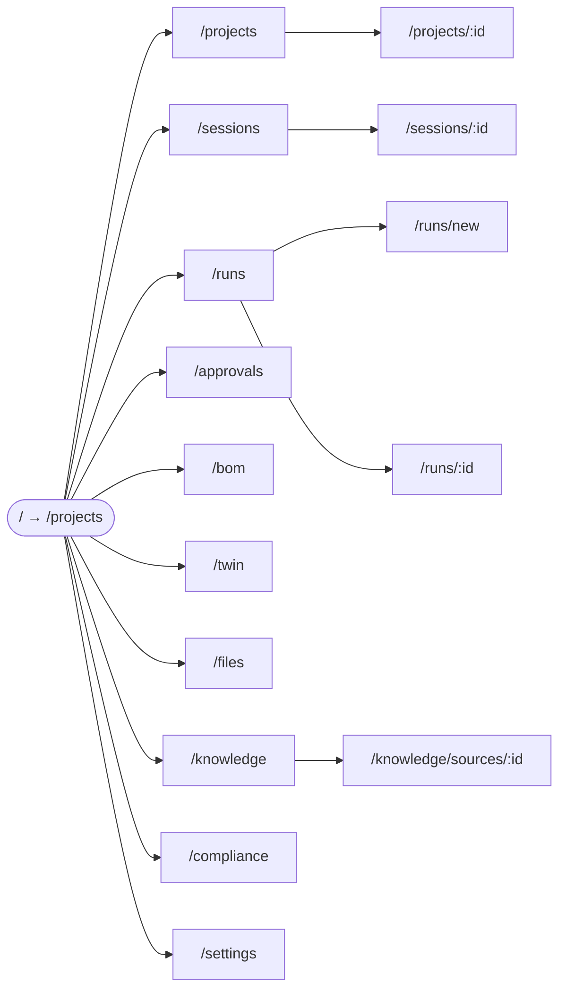
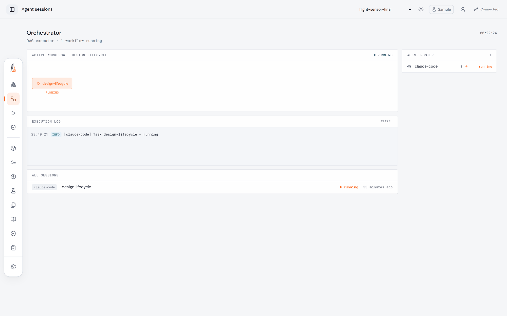
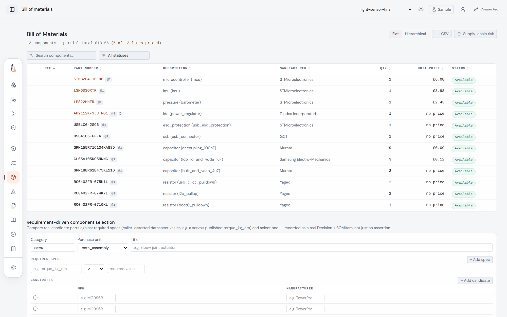
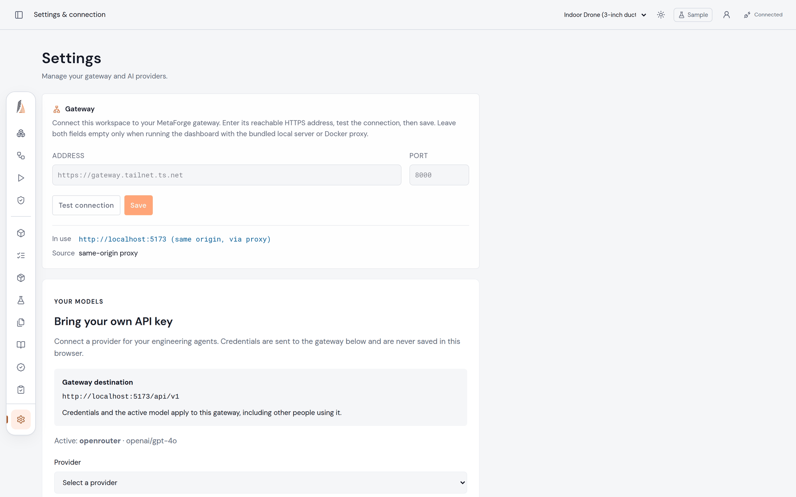

# Dashboard Tour

> **Status:** Phase 1 (v0.1). One section per route. Boot the app
> with `docker compose up gateway dashboard` then open
> `http://localhost:5173`. Layout sketches are ASCII. Last verified
> against `dashboard/src/App.tsx` on 2026-09-24.

## Look and feel

The dashboard is the MetaForge engineering workspace: light by default,
with a dark theme. The theme control in the topbar offers **Light**,
**Dark** and **System**; the choice is stored in the browser under
`metaforge.theme` and applied before first paint, so there is no flash
of the wrong theme.

Every colour resolves through a CSS variable in
`dashboard/src/styles/console.css`: the dark palette is defined on
`:root` and remapped for light mode under `[data-theme=light]`. The
accent is `#ff5a0a` in both themes. Type is DM Sans, with Roboto Mono
for identifiers and code. The 3D and robot viewers keep literal
colours, because WebGL can't read CSS variables.

## Layout shell

Every page except the full-width twin renders inside the same shell,
here with the rail expanded to show its labels:

- **Nav rail.** A floating rail with icon tooltips, in two groups
  (*Workspace* and *Engineering*), with **Settings & connection** and a
  **Documentation** link at the foot. The topbar toggle expands it to
  show labels and the full logo; the choice is remembered. Below 760px
  it becomes a drawer with a backdrop.
- **Topbar.** Breadcrumb (section, plus *Details* on a drill-in page),
  the active-project switcher, the theme control, the **Sample** link
  (opens the offline sample workspace; reads **Exit sample** while it
  is open), an account link to `/settings`, and the **gateway chip**,
  which reads *Connecting*, *Connected* or *Unavailable* from
  `GET /health`.
- A **Skip to main content** link is the first focusable element.

Every route below has a sidebar entry. Two entries run the other way —
**Requirements** (`/requirements`) and **Evals** (`/evals`) are in the
rail but have no section here yet. The default landing page is
`/projects`; unknown paths show a *Page not found* screen.

## `/projects`: project workspace

The home of the dashboard.

- **Backed by:** `GET /v1/projects`, `POST /v1/projects`,
  `GET /v1/runs`, `GET /health`.
- **Metric cards** link through to the library, `/runs`, `/approvals`
  and `/files`. **Review queue** lists runs waiting at an approval gate.
- When the gateway can't be reached, a **Connect your engineering
  gateway** notice offers *Retry* and *Set up connection* (`/settings`)
  and the cards show a dash instead of zero.

## `/projects/:id`: project detail

Drill-in for a single project: metrics, an action row (**Start design
run**, **Open twin & agent**, **Bill of materials**, **Baselines**) and the
project's artifact updates, newest first.

**Current items (FORGE-526).** By default the page lists one row per item
at its current revision, grouped by type (Parts, Assemblies, Requirements,
Intent, Needs, BOM, Components): its `KEY@n`, the gate and run that produced
it, its evidence state (current, out of date, none) and its validation
status. Older revisions are hidden; the panel header says how many. The
counts and the readiness percentage cover current items only, never every
node a run ever wrote. Decisions, simulation results and evidence stay
listed as records, and a result whose analysed revision is no longer current
moves to an **Out of date** group. Work products that are not items (a
pinmap, the PRD) are listed under **Other work products**. If the current
view cannot load, the page falls back to the flat work product list.

Everything else is opt-in:

- **Working** shows open runs' draft revisions, labelled DRAFT, under their
  item (and draft-only items), until a gate approves them.
- **N revisions** on a row opens the item's history: a timeline of
  revisions with status, run, gate, reason and the baselines that pin each.
  Tick two revisions to **compare** them: a 3D overlay with the older
  revision ghosted (parts and assemblies), volume, mass and bounding box
  deltas, the parameter table, requirement value changes, and the records
  still pinned to the older revision.
- **Baselines** lists the project's baselines (one per gate approval) and
  diffs any two, or one against the current items, item by item.

Each work product row has a **Preview** toggle (the eye icon). It opens a
compact preview under the row, on demand: the same engine the twin
inspector and the full-screen preview use (see
[Work product previews](#work-product-previews)), loaded only when first
opened.

- **Backed by:** `GET /v1/projects/{id}`, `GET /v1/twin/current-view`,
  plus `GET /v1/twin/items/{key}/revisions` and `/items/{key}/diff` for
  history and compare, `GET /v1/twin/baselines` and `/baselines/diff`, and
  `GET /v1/twin/nodes/{id}` and the twin file routes when a row preview is
  opened.
- **Use it to:** find a `work_product` UUID for the CLI's
  `--work_product` flag, rename or delete the project, or set it as the
  active project.

## `/sessions`: agent sessions

Each row is one captured agent session: status, owning agent, project,
last activity.

- **Backed by:** `GET /v1/sessions?project_id=…`.
- **Use it to:** find the session you want to dig into. Same data as
  `python -m cli.forge_cli status <id>` but in a clickable list.
- **Internal workflow runs carry no project**, so they drop out once one
  is selected. The page says "N internal workflow runs not shown: no
  project recorded" rather than just getting shorter — otherwise an empty
  page means both "nothing ran" and "everything that ran was internal",
  with no way to tell which.
- **The agent roster is derived, not declared.** It lists the agents that
  have actually run a session in this project — `chat-harness`, `mcp`,
  `claude-code` and so on — one row each, showing the most recent session's
  status and how many that agent has run. It used to be a hardcoded array
  of four discipline agents with invented statuses, including a pulsing
  "running spec" that nothing had measured. Those four do not exist as
  running things: `domain_agents/` holds the disciplines as code invoked
  during a run, and nothing keeps a per-discipline process with a status to
  report. An empty roster says so rather than showing the four.
- **The pending-approval card is scoped too.** It used to read proposals
  unscoped while `/approvals` read the same hook scoped, so reading one
  project's sessions could surface — and let you approve — a proposal
  belonging to another.

## `/sessions/:id`: session detail

Per-session timeline of thoughts, actions and decisions (see
[Session capture](session-capture.md)).

- **Backed by:** `GET /v1/sessions/{id}`.

## `/runs`: design runs

Every design-flow run **for the active project**, with search and a
status filter, and a **New design run** action.

- **Backed by:** `GET /v1/runs?project_id=…`.
- **Scoped since** the page listed every project's runs in one table —
  seven projects' work at once on the dev gateway — and a run's project
  existed only inside its untyped `request` blob, so nothing on a row
  told them apart. Each run now carries `project_id` as a real field.
- **Runs with no project are reported, not hidden.** Five of seventeen
  on the dev gateway carry none; with a project selected the page says
  "N runs not shown: no project recorded" rather than just getting
  shorter. Clear the active project to see them.

## `/runs/new`: start a design run

A two-step wizard: **Define the intent**, then **Review & launch**.

- **Backed by:** `GET /v1/projects`, and on launch
  `POST /v1/runs` with a `design_flow` request and `start: true`. On
  success it opens `/runs/:id`.
- **The flow choice is fetched, not hardcoded.** The page lists whatever
  `orchestrator/design_flow/templates/*.yaml` defines — today `design_v1`
  (*General design*, the default), `hardware_v1` and `mech_v1`.
- The lifecycle panel lists the selected flow's real phases; every phase
  has a human review gate. `/runs/new?project=<id>` preselects a project.

## `/runs/:id`: run detail

One run's phases, gate decisions and outputs. A run that can't be
loaded shows a *Run could not be loaded* state rather than *not found*.
**This run changed** lists the item revisions the run produced, with what
each gate did (approved into a baseline, waiting for the gate, or closed).

- **Backed by:** `GET /v1/runs/{id}`, `GET /v1/twin/runs/{id}/changes`.

## `/approvals`: human review

One queue for everything that needs a human, rendered by a single card
component: design-flow **gates**, flow proposals and versions, held
**tool calls**, human-authority requests, design changes, design loops,
sketches and drawings.

- **Backed by:** `GET /v1/approvals?status=pending|decided&project_id=…&kind=…`
  and `POST /v1/approvals/{id}/decision`. Every request carries
  `X-MetaForge-Surface: dashboard` so the audit trail records where a
  decision came from.
- **Each card shows:** title, kind, project, age and deadline, why the
  item was held, structured findings (errors, warnings and info are
  styled apart), and the kind's own detail: tool and arguments, the flow
  proposal's changes, the design change diff, or the gate's run, phase,
  attempt and retries left.
- **Decisions are exactly what the gateway allows.** The buttons are the
  item's `allowed_decisions` (approve, reject, retry, rework). A reason
  box appears for the decisions in `reason_required_for`, and rework
  asks for a phase from the item's `rework_targets`. When the item is not
  decidable the controls are disabled and show the gateway's reason. The
  dashboard no longer sends a hard-coded reviewer name; the gateway
  identifies the approver.
- **Audit tab:** decided items with who decided, from which surface, on
  whose behalf, whether the approver was verified, when, and the outcome.
- **Scoped to the active project.** Items with no project are counted and
  reported, because an approval that quietly disappears is the one
  nobody answers.
- **The run page uses the same card.** The gate dialog on `/runs/{id}`
  and the Approve and Reject buttons on the flow graph open the
  `gate:<run id>` approval in this card.
- **Use it to:** same outcome as
  `python -m cli.forge_cli approve <id> --reason …`.

## `/bom`: bill of materials

Per-row sourcing data with part images, purchase and datasheet links,
and prices in their own currency. Exports to CSV. Each component that is an
item revision shows its `@n` (marked *old* when it is not current); clicking
it opens the item's history. The Requirements page's matrix does the same
for each requirement, with its constraint set's revision.

A line with no price shows *no price*, not $0.00. When any line is
unpriced, the header total is labelled partial and says how many lines
are priced, so it is never read as the board cost.

- **Backed by:** `GET /v1/bom`, `GET /v1/twin/revision-index`.
- **Use it to:** sanity-check supply-chain coverage before a fab
  release.

## `/twin`: digital twin

The full-width twin workspace. A toolbar switches between **Graph**
(work products and their relationships), **Model** (the React Three
Fiber viewer for STEP, GLB, STL and 3MF geometry), **Sim** and **Assembly**. A status
strip counts nodes needing attention and nodes without relationships,
with a **Start design run** shortcut. Selecting a node opens the
inspector (*Overview*, *Constraints*, *History*) and a conversation
drawer for asking an agent about that node.

On the **Graph**, a work product is linked to more than other work
products: to the constraints it satisfies, the intent and evidence behind
it, the parts it contains and the baselines it belongs to (FORGE-704).
Work products are laid out in layers by dependency, left to right, so a
link mostly runs to the next column; a layer of more than eight wraps into
further columns rather than one tall stack. A link is named only when it
touches the node you have selected, and is otherwise told apart by colour.
Those records are drawn as lighter, dashed nodes in columns at the right,
and a row of switches above the graph, *Show links to* (its own row, not
floating over the nodes), turns each kind on
or off with how many links go to it. Links to baselines start off, because
baseline membership is one link per member and drowns the rest; the row
says how many links are hidden. Links that point *into* a work product (an
intent that depends on a CAD model) are drawn too. If the relationships
request fails the graph says so and shows only the work products, never
stand-in links, and if some work products' links could not be read it
says how many.

The **Electronics** tab (FORGE-687) draws the electronics and firmware
thread: BOM, schematic, board, then gerbers and pick and place, and from
the schematic the pin map and the firmware. Each stage shows the current
revision of what is recorded, with the sheet or board preview where there
is one, and each arrow is solid and labelled *generated from* only when
the later work product is linked `GENERATED_FROM` the earlier one in the
graph; *not linked* means both are recorded but the link was not passed
(`source_node_ids` on `twin.record_design_files`). An amber *from @1*
means the later work product was made from an earlier revision of the one
before it (the board from schematic @1, after the schematic moved to @2), so
it is out of date and wants regenerating. A stage with nothing recorded
names the tools that produce it.

The Model tab shows the model standing on a visible workplane, turned by
a Tinkercad-style turntable (FORGE-620). **Right-drag rotates,
middle-drag pans, the wheel zooms toward the cursor, and the left button
is left alone for selecting parts** — so orbiting and picking never
compete for the same gesture.

The camera's orientation is held as an azimuth and an elevation rather
than accumulated as a rotation, and the camera is rebuilt from those two
numbers every frame. That makes roll structurally impossible: the
workplane can never tilt and the model can never end up on its side. The
elevation stops just short of straight overhead and straight underneath,
which is what Tinkercad does too — crossing the pole would swing the
camera to the opposite side and invert the horizon. Horizontal rotation
is unbounded.

The pivot is the whole model's centre, so a single part of a large
assembly swings through a wide arc. **Double-click a part, or press F
with one selected, to frame it** — the camera fits its bounding sphere
and moves the pivot onto it. **Reset view** returns to the home
three-quarter view and frames the whole model. The view cube in the
corner jumps to a face.

CAD geometry is authored Z-up and the STEP converter keeps it that way,
so the viewer turns a loaded model a quarter turn onto its feet before
measuring it (FORGE-621) — the same correction the robot path has always
applied. Without it the workplane cut through the model and the camera
turned it about an axis that wasn't its up.

The workplane is one plane, carrying the grid and receiving the model's
shadow. It used to be two surfaces half a unit apart, which z-fought as
the camera moved and read as the floor shimmering (FORGE-623). The
camera's depth range follows the zoom rather than sitting at a fixed
10000, so pulling back no longer pushes the scene past the far plane and
out of sight, and shadows redraw when the geometry changes rather than on
every frame.

The workplane itself is a single mipmapped texture rather than drawn
lines, which is what keeps it still while the camera moves: a receding
patch of floor averages its cells into a flat tint instead of aliasing
into a crawling shimmer. Two earlier attempts shimmered for that reason
— a procedural shader anti-aliasing its lines with screen-space
derivatives (FORGE-34), then plain line segments with no anti-aliasing
at all (FORGE-612). It is sized and placed from the model's own bounds,
so it sits under whatever is loaded. A robot description carries no
bounds, so it gets no workplane rather than one at a guessed height.

A node that is a revision of an item (FORGE-526) shows a **revision
picker** (`KEY @n`) in the inspector Overview: picking another revision
selects that revision's node, and the Model tab reloads it. The *History*
tab adds the item's revision timeline and the compare view described under
[project detail](#projectsid-project-detail).

An assembly `cad_model` (one with `metadata.parts`, FORGE-511) shows an
**Assembly parts** tree in the inspector Overview and on the Assembly tab:
each part with its material and dimensions (from its position box).
Selecting a part highlights it in the tree and in the 3D viewer. The
Explorer rail pins a **Latest assembly** shortcut for the project above the
node list. The node's `assemblyParts` field in `GET /v1/twin/nodes` carries
the list.

Selecting a `simulation_result` node adds an **FEA result** panel to the
inspector: max von Mises and max displacement with their units, the
load case that produced them, the mesh statistics and, when the run
stored its field (FORGE-532), the 3D contour viewer described under
`/sim` below. A result recorded before fields were persisted shows a
*Field not stored* note instead of a contour. The panel links to `/sim`,
which is where two results compare side by side.

The panel is not the toolbar's **Sim** button, which is an unrelated
robotics-physics preview (gravity, joint constraints, a Run/Stop toggle
gated on a `robot_description` node) and shares nothing with an FEA
result but the word.

- **Backed by:** `GET /v1/twin/nodes`, `GET /v1/twin/relationships`,
  `GET /v1/twin/nodes/{id}/model`, `GET /v1/twin/nodes/{id}/file`,
  `GET /v1/twin/nodes/{id}/versions`, and the chat routes under
  `/v1/chat`. The FEA panel reads the node's own `meshStats` plus the
  scalar `max_von_mises_mpa` / `max_displacement_mm` / `load_case`
  properties, and its contour comes from
  `GET /v1/simulation/results/{id}/field`; `GET /v1/simulation/results`
  backs the `/sim` listing.
- **Sample workspace.** `/twin?demo=1&node=sample-pcb` (the topbar's
  **Sample** link) opens an illustrative drone flight-controller
  workspace that runs entirely in the browser with no gateway. It is
  labelled *Sample data · resets on refresh* and its assistant is
  scripted.

### Work product previews

One registry, `previewEngineFor` in
`dashboard/src/components/preview/registry.ts` (FORGE-531), picks how a
work product is previewed. The twin inspector, the full-screen
**Preview** modal and the project page rows all render its answer through
the same `PreviewHost`, so the three surfaces always agree.

The work product type wins where it carries the meaning; otherwise the
file format decides (the `format` property, or the `file_path`
extension); otherwise a per-type default applies.

| Engine | Picked for | Renders |
|---|---|---|
| 3D CAD | `.step`/`.stp`/`.iges`/`.brep`/`.fcstd`, a `cad_model` with no mesh format, any assembly (`metadata.parts`) | The STEP to GLB converter route (`GET /v1/twin/nodes/{id}/model`) in the 3D viewer. In the modal an assembly also shows its part tree. |
| 3D mesh | `.stl`, `.3mf`, `.glb`, `.gltf` | The stored file loaded directly with three.js loaders, in the main viewer and the modal. STL carries no colour, so it renders in a uniform neutral. |
| Markdown | `.md`, and `prd`, `documentation`, `test_plan` and the other document types | Formatted Markdown (headings, lists, tables, code). A fenced block tagged `mermaid` is drawn as a diagram rather than printed as its source (FORGE-706); one that will not parse falls back to the source with a note. Raw HTML in the source shows as text, and so does any markup inside a diagram's labels — mermaid runs sanitised. |
| PRD | a `prd` revision (`metadata.item_key` set, FORGE-528) | The derived prd from `GET /v1/twin/items/{KEY@n}/prd`: the prose plus the project's current intent, needs and a live requirement table read from the current constraint set, with the prose and constraint set revisions shown above it. Falls back to the stored prose, with a note, if the view cannot be fetched. A legacy prd with no item renders as Markdown. |
| Requirements table | `constraint_set` | One row per constraint: severity, domain, acceptance criteria, verification, binding. Falls back to Markdown if the document is not in the recorder's shape. |
| BOM table | `bom` (`.csv`) | Line items and total quantity over the CSV table. |
| Decision card | `design_decision` | Title, rationale, alternatives with why each was rejected, status. |
| CSV table | `.csv`, `.tsv` | A table, capped with a "Show all" for long files. |
| JSON tree | `.json` | A collapsible tree. Invalid JSON is shown as text with a warning. |
| Code | `.c`, `.h`, `.cpp`, `.py` and other sources, `firmware_source`, `cad_source_script` | Highlighted source with line numbers. |
| Design files | a `schematic`, `pcb_layout`, `gerber`, `pick_and_place`, `pinmap` or `firmware_source` kept by `twin.record_design_files` (FORGE-687) | A schematic's sheets or a board's top side as the SVGs `kicad.export_svg` made when it was recorded; a gerber set's layers drawn by tracespace in one shared box so they line up, each one switchable; a firmware project's files one at a time with its `firmware.elf` to download; a pin map or placement file as a table. Every file is listed with a download link. |
| KiCad viewer | `.kicad_sch`, `.kicad_pcb`, `schematic`, `pcb_layout` imported as a single file | No embeddable KiCad viewer ships as an npm package. Says so and offers the download; record the project with `twin.record_design_files` to get previews. |
| Gerber renderer | `.gbr`, `.gtl`, `.gbl` and the other layer extensions, `.drl` | The layer drawn by tracespace. A zipped Gerber set is not unpacked. |
| DXF viewer | `.dxf` | Lines, polylines, arcs, circles, ellipses, splines and text drawn from dxf-parser. |
| FEA summary | `simulation_result` | The FEA result card described above, with the 3D field viewer (FORGE-532) in the inspector and the modal; project rows show the numbers only. |
| Image, PDF, HTML sketch | `.png`/`.jpg`/`.svg`/`.webp`, `.pdf`, `.html` | As before. |
| Robot viewer | `robot_description` | Unchanged: open it in the main 3D viewer. |

Anything else gets **No preview engine for .ext files** with a download
link. The preview never shows a binary as text: only the text engines
fetch the file body. The inspector panel leaves 3D, robot, PDF and HTML to
the 3D viewer and the full-screen modal. The heavy engines (the 3D scene,
the Gerber and DXF renderers, the Markdown and table renderers) load on
first use, so the page bundles barely grow. Mermaid is a second step
further down: it loads only when a document actually contains a diagram,
not whenever one is previewed.

## `/sim`: simulation

Load cases (reusable boundary conditions, with a 3D face picker for the
fixed and loaded faces) and the project's FEA results.

Click a result's name to open it in 3D; the newest opens by default. The
viewer colours the solved mesh by von Mises stress, displacement magnitude
or temperature (pick one in the toolbar), with a legend showing the
full-field minimum, maximum and peak. The **Deform** slider scales the
displacement so the deflected shape is visible; it starts at a scale that
makes the largest deflection about 5% of the part size. Fixtures show as
blue boxes and loads as orange arrows (both also listed in the legend in
words), the peak as a white dot, and hovering the mesh reads out the value
under the cursor. A *Simplified from N triangles* note appears when the
stored surface was decimated to fit its size cap.

Tick two results to compare them: the numeric deltas, then the two fields
side by side with one camera (orbit either and both follow), one quantity
and one colour scale spanning both, so equal colours mean equal values. A
result that recorded a mesh-convergence sweep also shows a chart of peak
stress against element count with the *Converged* or *Not converged*
verdict. A result recorded without a field keeps its numbers and says
*Field not stored*.

- **Backed by:** `GET/POST /v1/simulation/load-cases`,
  `POST /v1/simulation/named-faces`, `GET /v1/simulation/results`,
  `GET /v1/simulation/results/{id}/field`. See
  [Simulation results in 3D](simulation-results.md).

## `/files`: files & artifacts

Every stored artifact, with download and file-link sync.

- **Backed by:** `GET /v1/twin/links` and the twin file routes.

## `/knowledge`: ingested sources

The L1 knowledge corpus as a sortable, filterable table.

- **Backed by:** `GET /v1/knowledge/sources` (the same data the
  `metaforge://knowledge/sources` MCP resource exposes).
- **Use it to:** see what's in the KB, filter by `knowledge_type` or
  project, click a row to drill in.
- Empty state: points you at `forge ingest <path>`; see
  [`cli-reference.md`](cli-reference.md).

## `/knowledge/sources/:id`: source detail

Drill-in for one source. The CLI's `sources show` command is the
fuller view for now (see [`cli-reference.md`](cli-reference.md)).

## `/compliance`: compliance

Regulatory coverage for the active project.

- **Backed by:** `GET /v1/compliance/{project_id}/checklist` and
  `/coverage`, plus evidence under `/v1/compliance/{project_id}/evidence`.

## `/settings`: settings & connection

Reached from **Settings & connection** at the foot of the nav rail, or
the account icon in the topbar.

**Gateway.** Which gateway the dashboard sends its API calls to, as an
address and a port, with a **Test connection** button that probes
`GET /health` before you commit to the value. Leaving both fields empty
keeps the default behaviour: same-origin relative paths, which the Vite
dev server and the Docker image's nginx both proxy to the gateway
themselves. Setting an address is what lets a separately hosted
dashboard (on Vercel, say) reach a gateway running on your own machine.
See [Vercel deployment](deployment/vercel.md) for that setup.

The value is held in `localStorage`, so it is per-browser and never
leaves the machine. Saving one clears the React Query cache, since
everything already fetched came from the previous gateway. The page
warns when the combination will be blocked as mixed content (an HTTPS
dashboard calling an HTTP gateway).

**Bring your own API key.** Pick a provider, paste a key and choose the
active model. Keys go straight to the gateway
(`POST /v1/harness/credentials`, `PUT /v1/harness/selection`) and are
never stored in the browser. If the gateway sets
`METAFORGE_HARNESS_ADMIN_TOKEN`, enter it in the **Admin token** field;
it is sent with the request and not saved.

**Before you expose a gateway.** The gateway ships no authentication on
its data routes; the page explains how to put it behind a private
network or an authenticating proxy.

## What's not on the dashboard yet

- **No dedicated MCP-tool runner UI.** Tool calls land via the CLI,
  Claude Code, or Codex; the dashboard shows their *results*
  (sessions, proposals, BOM updates) and asks for tool approvals.
- **No sign-in.** The gateway has no user accounts; access control is
  whatever network or proxy sits in front of it.

## Boot recipes

| Goal | Command |
|---|---|
| Dev mode (hot reload) | `docker compose up gateway dashboard-dev` |
| Prod build (static) | `cd dashboard && npm run build && npm run preview` |
| Just the gateway, drive UI elsewhere | `docker compose up gateway` then point dashboard at it |
